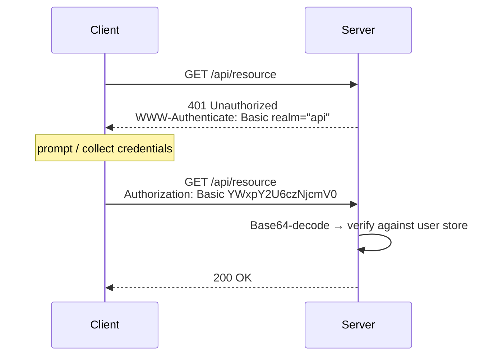

# Basic Authentication

## What it is

Basic Authentication is the simplest HTTP authentication scheme, defined in
[RFC 7617](https://www.rfc-editor.org/rfc/rfc7617). The client sends the
username and password — joined by a colon and Base64-encoded — in the
`Authorization` header of **every request**.

!!! danger "Base64 is encoding, not encryption"
    `Base64("alice:s3cret")` → `YWxpY2U6czNjcmV0`. Anyone who intercepts the
    header can decode it instantly — no key required. Basic Auth without TLS
    is equivalent to sending credentials in plaintext.

## How it works



On the wire:

```http
GET /api/resource HTTP/1.1
Host: api.example.com
Authorization: Basic YWxpY2U6czNjcmV0   (1)
```

1. `YWxpY2U6czNjcmV0` is the Base64 encoding of `alice:s3cret`.
   Paste it into any Base64 decoder to see the credentials.

If the credentials are missing or wrong, the server responds:

```http
HTTP/1.1 401 Unauthorized
WWW-Authenticate: Basic realm="api", charset="UTF-8"
```

The `WWW-Authenticate` header tells the client which scheme and *realm*
(protection space) applies. Browsers respond to it with the familiar
username/password popup.

## Reference implementation

=== "Python (FastAPI)"

    ```python
    import secrets
    from fastapi import Depends, FastAPI, HTTPException, status
    from fastapi.security import HTTPBasic, HTTPBasicCredentials

    app = FastAPI()
    security = HTTPBasic()

    # In production: load from a secrets store, never hardcode.
    USERS = {"alice": "s3cret"}

    def authenticate(credentials: HTTPBasicCredentials = Depends(security)):
        expected = USERS.get(credentials.username)
        # Constant-time comparison prevents timing attacks.
        if expected is None or not secrets.compare_digest(
            credentials.password.encode(), expected.encode()
        ):
            raise HTTPException(
                status_code=status.HTTP_401_UNAUTHORIZED,
                headers={"WWW-Authenticate": "Basic"},
            )
        return credentials.username

    @app.get("/api/resource")
    def resource(user: str = Depends(authenticate)):
        return {"hello": user}
    ```

=== "Java (Spring Security)"

    ```java
    @Configuration
    @EnableWebSecurity
    public class SecurityConfig {

        @Bean
        SecurityFilterChain filterChain(HttpSecurity http) throws Exception {
            http.authorizeHttpRequests(auth -> auth
                    .anyRequest().authenticated())
                .httpBasic(Customizer.withDefaults())
                // APIs are stateless — disable session creation.
                .sessionManagement(s -> s
                    .sessionCreationPolicy(STATELESS));
            return http.build();
        }

        @Bean
        UserDetailsService users(PasswordEncoder encoder) {
            var user = User.builder()
                .username("alice")
                .password(encoder.encode("s3cret"))
                .roles("API")
                .build();
            return new InMemoryUserDetailsManager(user);
        }

        @Bean
        PasswordEncoder passwordEncoder() {
            return new BCryptPasswordEncoder(); // never store plaintext
        }
    }
    ```

=== "Client (curl)"

    ```bash
    # -u performs the Base64 encoding for you
    curl -u alice:s3cret https://api.example.com/api/resource

    # Equivalent explicit form
    curl -H "Authorization: Basic $(printf 'alice:s3cret' | base64)" \
         https://api.example.com/api/resource
    ```

## Strengths & weaknesses

| Strengths | Weaknesses |
| --- | --- |
| Trivially simple; supported by every HTTP client ever made | Credentials travel with **every** request — maximizes exposure |
| Stateless — no session store required | Base64 offers zero protection without TLS |
| No handshakes, redirects, or token lifecycle | No expiry, rotation, or scoping mechanism built in |
| Browsers handle the 401 challenge natively | Logout is unreliable — browsers cache credentials |
| | Password verification per request → expensive password hashing hurts latency |

## Common attacks & mitigations

| Attack | Why Basic Auth is vulnerable | Mitigation |
| --- | --- | --- |
| Network sniffing | Credentials are effectively plaintext | **TLS mandatory**, reject port 80, enable HSTS |
| Brute force / credential stuffing | Password verified on every request; nothing to throttle by default | Rate limiting, lockout/backoff, WAF rules |
| Credential leakage in logs | Proxies and frameworks often log headers | Scrub `Authorization` header in all log pipelines |
| Timing attacks | Naive string comparison leaks password length/content | `compare_digest` (Python) / `MessageDigest.isEqual` (Java) |

## When to use / avoid

!!! success "Use it for"
    - Internal service-to-service calls inside a trusted network or mesh
    - Webhook receivers, health-check endpoints, dev/test environments
    - Bootstrapping (exchanging credentials once for a better token)

!!! failure "Avoid it for"
    - Public-facing APIs
    - Anything where credentials can't be rotated easily
    - Browser sessions for end users (the cached-credential UX is poor)

## Checklist

- [x] TLS enforced; HTTP redirects to HTTPS or is refused
- [x] Passwords stored hashed (bcrypt/argon2), never plaintext
- [x] Constant-time credential comparison
- [x] `Authorization` header scrubbed from logs
- [x] Rate limiting on all endpoints, not just login
- [x] `realm` set to a meaningful protection-space name
