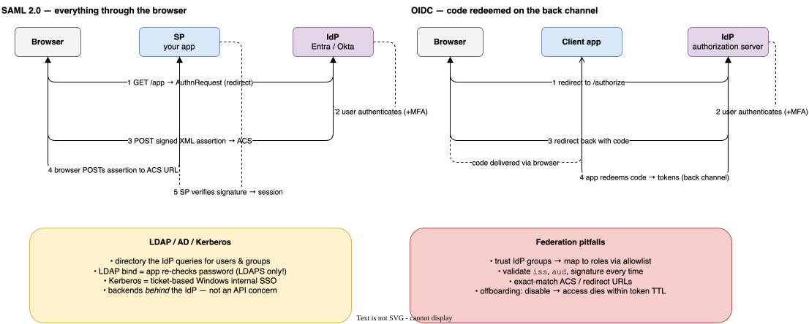

# Enterprise SSO: SAML, OIDC & Directory Backends

## What it is

Enterprise Single Sign-On lets employees authenticate **once** against a
corporate identity provider (IdP) — Microsoft Entra ID, Okta, Keycloak,
AD FS — and reuse that session across every connected application (the
Service Providers, or SPs). Your API never sees the corporate password;
it sees a signed assertion or token from the IdP it trusts.

Two federation protocols dominate, plus the directory backends that sit
behind them:

| Technology | Era | Token format | Transport | Typical use |
| --- | --- | --- | --- | --- |
| **SAML 2.0** | 2005 | XML assertion | Browser POST/redirect | Enterprise SSO, legacy SaaS |
| **OIDC** | 2014 | JWT (ID token) | Back-channel + redirect | Modern apps, mobile, APIs |
| **LDAP / AD** | 1993 | N/A — bind/search protocol | Direct TCP (389/636) | Directory lookup, legacy auth |
| **Kerberos** | 1980s | Service tickets | KDC protocol | Windows/AD internal SSO |

{ loading=lazy }

*Editable source: `docs/diagrams/enterprise-sso.drawio`*

## SAML 2.0

The browser relays messages between SP and IdP:

1. User hits the SP → SP generates an **AuthnRequest**, redirects the
   browser to the IdP.
2. User authenticates at the IdP (with MFA — see [MFA](mfa.md)).
3. IdP returns a signed **SAML assertion** via browser POST back to the
   SP's ACS (Assertion Consumer Service) endpoint.
4. SP verifies the signature against the IdP's published certificate and
   establishes a local session.

Key moving parts:

- **Assertion** — XML containing `NameID`, attributes (groups, email),
  conditions (`NotBefore`/`NotOnOrAfter`), and audience restriction.
- **Metadata** — XML documents each party publishes; SPs import IdP
  metadata to get the signing certificate and endpoints.
- **ACS URL** — the POST-back endpoint. An attacker-controlled ACS URL in
  a misconfigured SP is an account-takeover primitive: validate it
  strictly.

!!! warning "XML signature wrapping (XSW)"
    The classic SAML attack: inject a forged *second* assertion and move
    the signature so the parser validates one assertion but consumes the
    other. Only current, patched SAML libraries resist it — never parse
    assertions with a generic XML parser, and pin your library version.

## OIDC vs SAML — choosing today

| | SAML 2.0 | OIDC |
| --- | --- | --- |
| Token | XML assertion, signed | JWT ID token, signed |
| Token reaches | Browser → SP | Client (APIs get separate access tokens) |
| API support | None natively | First-class — same server issues access tokens |
| Mobile/SPA | Painful | Designed for it |
| Ecosystem | Entrenched in enterprise SaaS | Standard for anything new |

Rule of thumb: **new builds use OIDC**; you integrate SAML when an
enterprise customer's IdP or a legacy SaaS requires it. Many IdPs speak
both, so you front the app with OIDC and let the IdP federate upstream
however it likes.

## LDAP & Active Directory

LDAP is a **directory protocol**, not an SSO protocol. Two common patterns:

- **LDAP bind auth** — the app takes username+password and attempts an
  LDAP bind as that user. If the bind succeeds, the password is right.
  Simple, but the app *sees the plaintext password*, works only over
  `ldaps://` (or StartTLS), and produces no SSO — every app re-prompts.
- **Directory lookup** — after some other authentication, the app (or
  IdP) queries LDAP/AD for the user's groups and attributes to drive
  authorization.

Kerberos is AD's native SSO mechanism — tickets from a KDC let users
access services without re-authenticating. You mostly encounter it as
"Integrated Windows Authentication" (SPNEGO/`Negotiate` header) on
internal web apps.

```python
# LDAP bind auth — the minimum viable check, over LDAPS only
import ldap3

def bind_auth(upn: str, password: str) -> bool:
    server = ldap3.Server("ldaps://ad.example.com:636")   # never :389
    try:
        conn = ldap3.Connection(server, user=upn, password=password,
                                auto_bind=True)
    except ldap3.core.exceptions.LDAPBindError:
        return False
    conn.unbind()
    return True
```

## Federation pitfalls that bite APIs

| Pitfall | Why it matters | Fix |
| --- | --- | --- |
| **Group claims → local roles blindly mapped** | IdP groups are coarse and attacker-influenceable via group-join policies | Map groups to roles server-side with an explicit allowlist; never accept role claims the client chose |
| **Stale access after offboarding** | Disabled-in-AD users keep valid tokens until expiry | Short token TTLs; session/access-token revocation checks on the IdP |
| **`iss`/`aud` not validated** | A token from *any* tenant of the same IdP is accepted | Validate issuer and audience exactly — per-tenant `iss` in multi-tenant IdPs |
| **JIT provisioning trusts everything** | Auto-created accounts inherit whatever attributes arrive | Constrain auto-provisioned users to a default role; flag privilege-bearing attributes |
| **ACS/redirect URLs laxly matched** | Assertions or codes delivered to attacker domains | Exact-match registered URLs; no wildcard subdomains |

## When to use / avoid

!!! success "Use it for"
    - Any B2B or internal product — customers *will* demand SSO, and
      building per-enterprise connections early is cheaper
    - Centralizing joiner/mover/leaver lifecycle in one place
    - OIDC for anything new; SAML only where the counterparty requires it
    - LDAP bind for legacy apps that can't federate — over LDAPS only

!!! failure "Avoid"
    - Rolling your own SAML/OIDC stack — use a library or managed IdP;
      XML signature validation in particular is a minefield
    - Exposing LDAP bind to the public internet
    - Treating federation as authorization — group claims still need a
      [local policy layer](../authorization/policy-engines.md)

## Checklist

- [x] Signature + `iss` + `aud` + expiry verified on every assertion/token
- [x] ACS and redirect URIs exact-matched to registered values
- [x] SAML handled by a maintained, patched library (XSW class of bugs)
- [x] LDAP traffic on LDAPS/StartTLS only; bind DNs are least-privilege
- [x] IdP group claims mapped through a server-side allowlist, never
      trusted verbatim
- [x] Offboarding tested: disabling a user kills access within token TTL
- [x] Step-up/MFA enforced at the IdP; `acr`/`amr` checked where required
