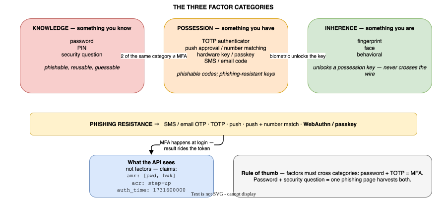

# Multi-Factor Authentication (MFA)

## What it is

MFA requires a user to present **two or more factors from different
categories** before authentication succeeds. It is a *user-login* control,
not a wire protocol — APIs don't "do MFA" on each request. Instead, MFA
strengthens the initial authentication event, and its result is propagated
to services via claims (`acr`, `amr`) on the tokens that login produces.

The three classic factor categories:

| Category | "Something you…" | Examples |
| --- | --- | --- |
| Knowledge | know | Password, PIN, security questions |
| Possession | have | TOTP authenticator, push approval, hardware key, SMS code |
| Inherence | are | Fingerprint, face, behavioral biometrics |

Two factors from the *same* category (password + security question) do not
count as MFA — a single phishing page harvests both.

{ loading=lazy }

*Editable source: `docs/diagrams/mfa-factors.drawio`*

## How methods compare

| Method | Phishing-resistant? | Downsides |
| --- | --- | --- |
| **SMS OTP** | No | SIM-swap, SS7 interception, NIST-deprecates for new systems |
| **Email OTP** | No | Only as strong as the mailbox — often resets *to* the same account |
| **TOTP** (authenticator app) | No — phishable in real time | Seed must be stored server-side (encrypted); device loss |
| **Push approval** | Weak — MFA fatigue works | Approve-bombing, "is this you?" ambiguity; add number-matching |
| **Push + number matching** | Partial | Still relayable in real-time phishing |
| **Passkeys / WebAuthn** | **Yes** — origin-bound challenge | Device/ecosystem dependency; see [Passkeys](passkeys.md) |

!!! warning "MFA fatigue is a real attack"
    Attackers with a stolen password spam push notifications until the
    victim taps "Approve" to make it stop. Uber (2022) was breached this
    way. Mitigate with number-matching prompts, rate limits on push
    attempts, and alerts on repeated denials.

## Step-up authentication

Re-authenticating *inside* a session for sensitive operations. The API
asks for a fresh factor before allowing high-risk actions:

- Changing password, email, or payout details
- Assigning roles or elevating privileges (see
  [RBAC worked example](../authorization/rbac-design.md))
- Exporting bulk data, disabling security features

Implementation: the authorization server supports the `acr` claim
(Authentication Context Class Reference). The API checks that the token's
`acr` meets the required level — e.g. `urn:mace:incommon:iap:silver` vs.
a step-up level — or that `amr` (Authentication Methods Reference)
includes `"mfa"` with a recent `auth_time`.

```http
HTTP/1.1 403 Forbidden
WWW-Authenticate: Bearer error="insufficient_user_authentication",
  acr_values="step-up"
```

The client then redirects the user through a fresh authentication
requesting `acr_values=step-up`, which forces a second factor even though
the session is live.

## How APIs consume MFA results

The API never sees the second factor — it sees **claims**:

| Claim | Carries | Example |
| --- | --- | --- |
| `amr` | *How* the user authenticated | `["pwd", "otp", "hwk"]` |
| `acr` | *Assurance level* of the whole process | `urn:federation:level2` |
| `auth_time` | *When* authentication happened | Unix timestamp — check freshness |

A resource server protecting a sensitive endpoint enforces:

```python
claims = verify_jwt(token)
if claims["acr"] != "step-up" or time.time() - claims["auth_time"] > 300:
    raise Forbidden("step-up authentication required")
```

## Reference implementation

=== "Python (TOTP enrollment + verify)"

    ```python
    import pyotp, secrets
    from argon2 import PasswordHasher

    ph = PasswordHasher()

    def enroll_totp(user):
        secret = pyotp.random_base32()          # 160-bit seed
        store_encrypted(user.id, secret)        # encrypt at rest!
        uri = pyotp.totp.TOTP(secret).provisioning_uri(
            name=user.email, issuer_name="YourAPI")
        return uri                              # render as QR code

    def verify_totp(user, code: str) -> bool:
        secret = load_encrypted(user.id)
        totp = pyotp.TOTP(secret)
        return totp.verify(code, valid_window=1)  # ±30s clock drift

    def issue_recovery_codes(user, n=10):
        codes = [secrets.token_hex(5) for _ in range(n)]
        for c in codes:
            save(user.id, ph.hash(c), used=False) # store hashed
        return codes                              # show once, then gone
    ```

=== "Java (Spring Security — require MFA for an endpoint)"

    ```java
    @Bean
    SecurityFilterChain api(HttpSecurity http) throws Exception {
        http.authorizeHttpRequests(auth -> auth
            // step-up required: token must carry the MFA authority
            .requestMatchers("/api/admin/**")
                .hasAuthority("FACTOR_OTP")
            .anyRequest().authenticated());
        return http.build();
    }
    ```

    Map `amr` claims to authorities in your JWT converter:
    `amr` containing `"otp"` or `"hwk"` → `FACTOR_OTP`.

## Strengths & weaknesses

| Strengths | Weaknesses |
| --- | --- |
| Kills the credential-stuffing → account-takeover path | Usability friction — drives abandonment if over-triggered |
| Limits damage from phished passwords (if method is strong) | Recovery flow is the weakest link — attackers target it |
| Step-up auth protects high-risk ops without annoying everyone | SMS/TOTP still phishable in real-time proxy attacks |
| `acr`/`amr` claims make assurance auditable and enforceable | Device loss handling adds operational complexity |

## Common attacks & mitigations

| Attack | Mechanism | Mitigation |
| --- | --- | --- |
| **MFA fatigue** | Spam push approvals until user taps yes | Number matching, cap push attempts, alert on denials |
| **SIM swap** | Attacker ports victim's number, gets SMS OTP | Prefer TOTP/passkeys; carrier PIN; risk-score SIM-age |
| **Real-time phishing (AiTM)** | Proxy relays credentials *and* OTP live | Phishing-resistant factors (WebAuthn); detect proxy domains |
| **Recovery-code abuse** | Support-desk social engineering, or codes stored plaintext | Hash recovery codes; strong identity proofing at support |
| **TOTP seed theft** | Seeds stored unencrypted in the DB → cloneable second factor | Encrypt seeds (KMS); treat as secrets, not config |
| **Session cookie theft post-MFA** | Attacker skips MFA entirely by stealing the cookie | Short session TTLs, device binding, token binding |

## When to use / avoid

!!! success "Use it for"
    - Any system with human users and meaningful data — credential
      stuffing alone justifies it
    - Admin consoles, role assignment, and payout/PII endpoints — as
      **step-up** requirements
    - Accounts that can be phished — prefer WebAuthn/passkeys as the
      strong factor where device support allows

!!! failure "Avoid relying on it for"
    - Machine-to-machine auth — services have no second factor; use
      [mTLS](mtls.md) or workload identity instead
    - Compensating for broken authorization — MFA proves *who*; it says
      nothing about [object-level access](../authorization/object-level.md)
    - Low-assurance flows where SMS is the only option and a strong
      alternative exists

## Checklist

- [x] At least one phishing-resistant factor offered (passkey/WebAuthn)
- [x] `amr`/`acr` claims checked server-side for sensitive endpoints
- [x] Step-up flow for role assignment, payout, and credential changes
- [x] Recovery codes generated once, shown once, stored hashed
- [x] Push notifications rate-limited and use number matching
- [x] TOTP seeds encrypted at rest via KMS
- [x] Login anomaly detection (new device, impossible travel) can force
      re-verification
