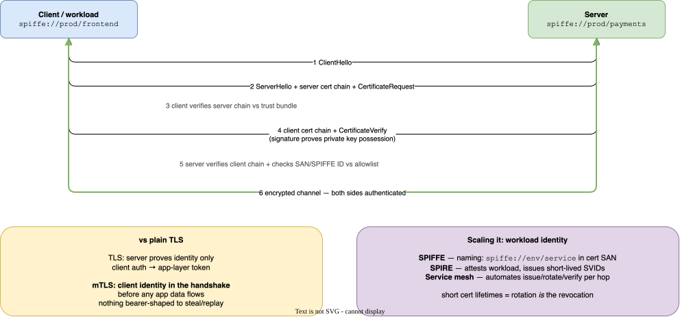

# Mutual TLS (mTLS)

## What it is

In ordinary TLS only the **server** proves its identity — the client
verifies the server's certificate, and authentication of the *caller* is
left to some application-layer credential (token, password, key). In
**mutual TLS** both sides present certificates: the client proves *who it
is* during the handshake itself, before a single byte of application
data flows.

The identity is the certificate — typically an X.509 cert issued by an
internal CA, whose subject (or SAN) names the workload. No bearer token
exists to steal from a log or replay from another context: possession of
the private key is proven cryptographically in every connection.

{ loading=lazy }

*Editable source: `docs/diagrams/mtls-handshake.drawio`*

## How it works

1. Client connects, receives the server cert, verifies it against its
   trust bundle — same as normal TLS.
2. Server sends `CertificateRequest`; client responds with its own cert
   chain plus a `CertificateVerify` signature over the handshake,
   proving it holds the private key.
3. Server verifies the client chain against the **client CA** bundle and
   extracts the identity from the subject/SAN.
4. Both sides now have authenticated channel + authenticated peer;
   authorization still decides what the identity may do.

```python
# Python (requests) — present a client certificate
import requests

resp = requests.get(
    "https://payments.internal/api/orders",
    cert=("client.pem", "client-key.pem"),   # client identity
    verify="/etc/pki/internal-ca.pem",        # trust bundle for the server
)
```

```nginx
# nginx — require and verify client certs at the edge
server {
    listen 443 ssl;
    ssl_certificate         server.pem;
    ssl_certificate_key     server-key.pem;
    ssl_client_certificate  internal-client-ca.pem;  # who may connect
    ssl_verify_client       on;                      # enforce mTLS

    location / {
        proxy_pass http://upstream;
        # carry the verified identity to the app — the app must NOT trust
        # this header from anywhere else
        proxy_set_header X-Client-DN $ssl_client_s_dn;
    }
}
```

!!! warning "The gateway-forwards-identity footgun"
    When mTLS terminates at a proxy, the identity arrives in a header
    (`X-Client-DN`, `X-Forwarded-Client-Cert`). If a caller can reach the
    upstream *without* the proxy — or the upstream accepts arbitrary
    headers — the whole scheme collapses. Either propagate mTLS
    end-to-end or strictly isolate the upstream network path.

## Workload identity: SPIFFE/SPIRE and service mesh

Hand-managing thousands of short-lived client certs doesn't scale, which
is why mTLS is usually delivered through a **workload identity
framework**:

- **SPIFFE** — the naming standard: a workload gets a URI-form ID like
  `spiffe://prod/payments-api` carried in the cert's SAN.
- **SPIRE** — issues short-lived SVIDs (certs) to workloads after
  attesting them against the platform (node, K8s SA, cloud identity).
- **Service mesh** (Istio, Linkerd, Consul Connect) — sidecar/proxyless
  proxies do all of this transparently: cert issuance, rotation, mTLS on
  every hop, identity-based policy.

This is the modern reason mTLS won for **east-west** (service-to-service)
traffic: rotation and issuance are automated, certs live minutes not
years, and the private key never leaves the workload.

## Strengths & weaknesses

| Strengths | Weaknesses |
| --- | --- |
| Strong, non-bearer authentication — no token to leak or replay | Operational weight: CA, issuance, rotation, revocation |
| Authentication *and* encryption in one layer | Doesn't fit user auth — humans don't hold certs conveniently |
| Identity bound to the connection — MITM-resistant by design | L7 middleboxes (WAF, some LBs) may break it or need passthrough |
| Mature: TLS libraries everywhere; mesh automates it | Cert lifecycle done badly (long-lived, shared keys) is worse than tokens |
| Enables least-privilege at the network layer (policy on SPIFFE ID) | Debugging is harder — failures happen before HTTP |

## Common attacks & mitigations

| Attack | Mechanism | Mitigation |
| --- | --- | --- |
| **Stolen private key** | Cert+key file lifted from disk → full impersonation until expiry | Short-lived certs, keys in TPM/HSM or tmpfs, workload attestation |
| **Over-trusting CA** | One internal CA signs certs for everything → any cert authenticates anywhere | Separate CA domains (trust bundles per env); check SPIFFE ID/path, not just chain |
| **Missing identity check** | Chain verifies but SAN is never inspected → any valid client cert passes | Match expected SPIFFE ID/CN allowlist *after* chain validation |
| **Cert expiry/renewal outage** | Long-lived cert lapses → self-inflicted DoS | Automate rotation well inside lifetime; monitor expiry |
| **Revocation lag** | CRL/OCSP not checked → compromised cert still works | Prefer *very* short cert lifetimes over revocation infrastructure |
| **Bypassed gateway** | Caller reaches upstream directly; trust-header spoofed | Network-isolate upstream; enforce mTLS end-to-end |

## When to use / avoid

!!! success "Use it for"
    - Service-to-service / east-west traffic — especially via a service
      mesh that automates it
    - Partner/B2B APIs where the caller population is small and managed
    - High-assurance environments (PCI, HIPAA, zero-trust mandates)
    - Workload identity with SPIFFE/SPIRE when you want short-lived,
      attested identity

!!! failure "Avoid it for"
    - Browser/mobile end-user auth — UX is hostile; use OIDC/sessions
    - Public APIs with many third-party callers — cert onboarding
      doesn't scale; use OAuth client credentials
    - Cases where you need per-*request* identity granularity (impersonation,
      delegation) — layer tokens on top

## Checklist

- [x] Server verifies client chain *and* checks SAN/SPIFFE ID against an
      allowlist
- [x] Private keys never on shared disks or in images; TPM/HSM or
      memory-only where possible
- [x] Cert lifetimes short (hours–days for workloads); rotation automated
- [x] Trust bundles scoped per environment — prod CA ≠ dev CA
- [x] Identity headers from the TLS terminator stripped/overwritten on
      ingress — never forwarded from the edge
- [x] Expiry alerting and rotation drills practiced
- [x] Authorization still enforced — mTLS proves *who*, not *what's allowed*
