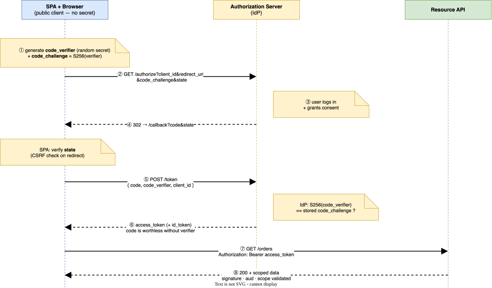

# OAuth 2.0 (& OpenID Connect)

## What it is

OAuth 2.0 ([RFC 6749](https://www.rfc-editor.org/rfc/rfc6749),
[security BCP RFC 9700](https://www.rfc-editor.org/rfc/rfc9700)) is a
**delegated authorization framework**. It lets a third-party application
access a user's resources *without ever seeing the user's password* — the
user approves access at the provider, and the app receives a scoped access
token instead of credentials.

**OpenID Connect (OIDC)** is a thin identity layer on top of OAuth 2.0 that
adds authentication: it returns an `id_token` (a JWT) proving *who* logged
in, not just what the client may access.

!!! info "OAuth ≠ authentication by itself"
    An OAuth access token says "this client may do X on behalf of user Y."
    It doesn't tell the client who the user is. If you need login/identity,
    use OIDC on top — that's what "Sign in with Google/GitHub" actually is.

## The four roles

| Role | Who | Example |
| --- | --- | --- |
| **Resource Owner** | The user who owns the data | You |
| **Client** | The app requesting access | A photo-printing app |
| **Authorization Server** | Issues tokens after user consent | Google/GitHub/Auth0/Keycloak |
| **Resource Server** | The API holding protected data | Google Photos API |

## Grant types

| Grant | Use case | Status |
| --- | --- | --- |
| **Authorization Code + PKCE** | Web apps, mobile apps, SPAs — anything with a user | The default for user flows |
| **Client Credentials** | Machine-to-machine, no user involved | Standard for service auth |
| **Device Authorization** | TVs, CLI tools, input-constrained devices | RFC 8628 |
| Refresh Token | Renewing access tokens offline | Companion to the above |
| ~~Implicit~~ | Old SPAs | **Deprecated** — tokens in URL fragments |
| ~~Resource Owner Password~~ | Client collects user password directly | **Deprecated** — trains users to share passwords |

## Authorization Code + PKCE flow

PKCE (Proof Key for Code Exchange, RFC 7636) protects the flow even when
the client can't keep a secret (SPAs, mobile apps). The client hashes a
random `code_verifier` into a `code_challenge`; the auth server returns the
code only to whoever presents the original verifier.

{ loading=lazy }

*Editable source: `docs/diagrams/pkce-flow.drawio`*

### The parameters that matter

| Parameter | Purpose |
| --- | --- |
| `client_id` | Identifies the app to the auth server |
| `redirect_uri` | Where the code goes — must be pre-registered **exactly** |
| `scope` | What the client asks for (`read:photos`, `openid profile`) |
| `state` | Random nonce — prevents CSRF on the redirect |
| `code_challenge` / `code_verifier` | PKCE — binds the code to this client instance |
| `response_type=code` | The code itself is *not* a token — it's exchanged back-channel |

## The three tokens

| Token | Format | Audience | Purpose |
| --- | --- | --- | --- |
| **Access token** | JWT or opaque | Resource server | Authorization — call APIs |
| **ID token** (OIDC only) | JWT | The client | Authentication — who logged in |
| **Refresh token** | Opaque | Auth server only | Get new access tokens silently |

!!! warning "ID tokens are not API credentials"
    Never send an `id_token` to a resource server. It proves identity to
    *your app* only. APIs accept **access tokens**.

## Reference implementation

=== "Python (client — Authlib)"

    ```python
    from authlib.integrations.flask_client import OAuth

    oauth = OAuth(app)
    oauth.register(
        name="example",
        client_id="YOUR_CLIENT_ID",
        client_secret="YOUR_CLIENT_SECRET",
        server_metadata_url="https://auth.example.com/.well-known/openid-configuration",
        client_kwargs={"scope": "openid profile read:photos"},
    )

    @app.route("/login")
    def login():
        redirect_uri = url_for("callback", _external=True)
        # PKCE + state are generated automatically
        return oauth.example.authorize_redirect(redirect_uri)

    @app.route("/callback")
    def callback():
        token = oauth.example.authorize_access_token()
        userinfo = oauth.example.userinfo(token=token)
        session["user"] = userinfo
        return redirect("/dashboard")

    # Call the resource API with the access token
    resp = oauth.example.get("https://api.example.com/photos", token=token)
    ```

=== "Java (client — Spring Boot)"

    ```yaml
    spring:
      security:
        oauth2:
          client:
            registration:
              example:
                client-id: YOUR_CLIENT_ID
                client-secret: YOUR_CLIENT_SECRET
                scope: openid,profile,read:photos
            provider:
              example:
                issuer-uri: https://auth.example.com
    ```

    ```java
    @Bean
    SecurityFilterChain filterChain(HttpSecurity http) throws Exception {
        http.authorizeHttpRequests(a -> a
                .requestMatchers("/", "/login").permitAll()
                .anyRequest().authenticated())
            .oauth2Login(Customizer.withDefaults());   // handles the whole flow
        return http.build();
    }
    // PKCE is enabled by default for public clients in Spring Security 6
    ```

=== "Java (resource server side)"

    ```java
    @Bean
    SecurityFilterChain api(HttpSecurity http) throws Exception {
        http.authorizeHttpRequests(a -> a
                .requestMatchers("/photos/**")
                    .hasAuthority("SCOPE_read:photos")   // enforce scopes!
                .anyRequest().authenticated())
            .oauth2ResourceServer(o -> o.jwt(Customizer.withDefaults()));
        return http.build();
    }
    ```

=== "Machine-to-machine (Client Credentials)"

    ```bash
    curl -u "$CLIENT_ID:$CLIENT_SECRET" \
      -d "grant_type=client_credentials&scope=read:photos" \
      https://auth.example.com/oauth/token

    curl -H "Authorization: Bearer $ACCESS_TOKEN" \
      https://api.example.com/photos
    ```

## Strengths & weaknesses

| Strengths | Weaknesses |
| --- | --- |
| User credentials never reach the third party | Most complex scheme in this guide — many moving parts |
| Granular, revocable scopes — least privilege by design | Misconfigured `redirect_uri`/`state`/`scope` → account takeover |
| Standardized — every major provider speaks it | "OAuth is a framework" — implementations vary in subtle ways |
| Tokens are short-lived; refresh is silent for users | Requires HTTPS everywhere + careful secret management |
| Delegation model maps to real business needs | Consent fatigue — users click "Allow" without reading |

## Common attacks & mitigations

| Attack | Mechanism | Mitigation |
| --- | --- | --- |
| **Redirect URI manipulation** | Attacker registers/uses `https://client.com.evil.com` or open redirectors to steal the auth code | Exact-match redirect URIs server-side; no wildcards |
| **Authorization code interception** | Malicious app claims the custom-scheme redirect on mobile | PKCE — stolen code is useless without the verifier |
| **CSRF on the redirect** | Attacker tricks victim's browser into completing *their* flow, binding victim to attacker's account | `state` nonce, validated on callback |
| **Token leakage** | Access tokens in URL fragments/history (why Implicit died), logs, referers | Code flow keeps tokens on the back-channel; scrub logs |
| **Consent phishing** | Malicious app with a lookalike name requests broad scopes | Scope review, publisher verification, user education |
| **Client secret theft** | Secrets embedded in SPAs/mobile apps are extractable | Public clients use PKCE *without* secrets; confidential clients keep secrets server-side |

## When to use / avoid

!!! success "Use it for"
    - Third-party integrations ("Sign in with X", API access on behalf of users)
    - SPAs and mobile apps needing user authentication (Auth Code + PKCE + OIDC)
    - Service-to-service auth at scale (Client Credentials)
    - Anything needing scoped, auditable, revocable access

!!! failure "Avoid it for"
    - Simple internal APIs where an API key suffices — don't adopt the
      whole ceremony for one partner
    - Teams without the capacity to operate/monitor an auth server —
      use a managed IdP (Auth0, Cognito, Keycloak) instead of building

## Checklist

- [x] Authorization Code + PKCE for all user flows — never Implicit or ROPC
- [x] `state` generated and validated on every flow
- [x] `redirect_uri` exact-match, HTTPS-only, pre-registered
- [x] Access tokens short-lived (≤1h); refresh tokens rotated on use
- [x] Scopes enforced at the resource server, not just requested
- [x] Client secrets server-side only; public clients carry none
- [x] `id_token` validated for `iss`, `aud`, `exp` and never sent to APIs
