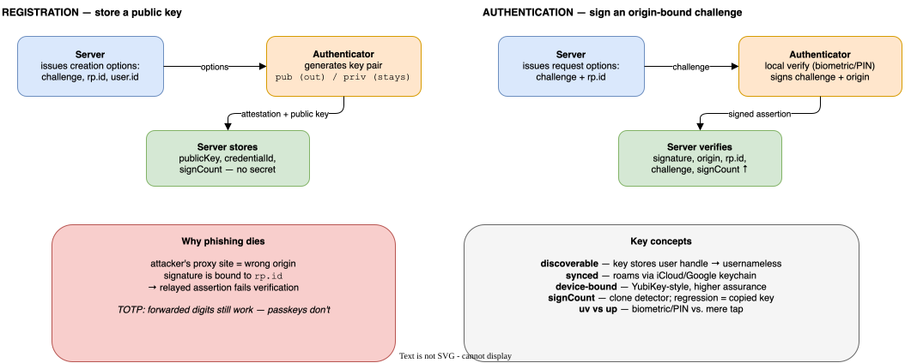

# Passkeys & WebAuthn

## What it is

Passkeys are **public-key credentials** that replace passwords. At
registration the device generates a key pair; the private key never
leaves the device (or the user's encrypted keychain sync), and the server
stores only the public key. At login the server issues a random
challenge; the authenticator signs it — proving possession of the private
key — after a local user-verification gesture (biometric or PIN).

Two standards make it work:

| Standard | Role |
| --- | --- |
| **WebAuthn** | Browser/JS API between your app and the authenticator |
| **FIDO2 / CTAP** | Protocol between the authenticator and the device (USB, NFC, BLE, platform) |

The property that changes the security game: the signed challenge
includes the **relying party ID (origin)**. A credential produced while
the browser sits on `evil-proxy.com` is useless for `your-app.com` —
phishing dies at the cryptography layer, not the user-vigilance layer.

{ loading=lazy }

*Editable source: `docs/diagrams/passkey-ceremony.drawio`*

## The two ceremonies

=== "Registration (attestation)"

    1. Server sends `PublicKeyCredentialCreationOptions` — random
       `challenge`, `rp.id`, `user.id`, accepted algorithms.
    2. Authenticator generates a key pair, signs an **attestation
       object** including the public key.
    3. Server verifies the challenge and (optionally) the authenticator's
       attestation chain, then stores `publicKey`, `credentialId`,
       `signCount`.

=== "Authentication (assertion)"

    1. Server sends `PublicKeyCredentialRequestOptions` — random
       `challenge`, `rp.id`, allowed credential IDs.
    2. User verifies locally (biometric/PIN); authenticator signs
       `challenge` + `origin` + `rpIdHash`.
    3. Server verifies the signature with the stored public key, checks
       the origin matches, and bumps `signCount`.

```python
# Server side — verify an assertion (using the webauthn library)
from webauthn import verify_authentication_response

verification = verify_authentication_response(
    credential=assertion_json,                # from navigator.credentials.get()
    expected_challenge=session["challenge"],  # one-time, from your session store
    expected_origin="https://app.example.com",
    expected_rp_id="app.example.com",
    credential_public_key=stored.public_key,
    credential_current_sign_count=stored.sign_count,
)
# verification.new_sign_count must be > stored count — cloned authenticator check
```

!!! warning "The challenge must be server-generated and one-time"
    If the challenge is predictable or reusable, the signature becomes a
    static credential — replayable forever. Generate ≥128-bit challenges
    server-side, bind them to the session, expire them in ~60s, and never
    accept a challenge you didn't issue.

## Key concepts

| Concept | What it means |
| --- | --- |
| **Discoverable (resident) credential** | Key stores the user handle on-device → username-less login |
| **Synced vs. device-bound** | Synced passkeys roam via iCloud/Google keychain (convenient); device-bound keys (YubiKey) stay put (higher assurance) |
| **`signCount`** | Authenticator's clone-detection counter — regression means the key was copied |
| **Attestation** | Authenticator proves its model/provenance at registration — required if you only trust certified hardware |
| **`uv` / `up` flags** | Whether the user was *verified* (biometric/PIN) vs. merely *present* (tap) |

## Passkeys in the API picture

Passkeys authenticate **users to your identity layer** — the API
downstream still sees the usual tokens. A typical composition:

1. User logs in with a passkey at your IdP / app login.
2. Login yields a session cookie or OIDC access token as usual.
3. APIs enforce authorization exactly as before.

So passkeys replace the *password factor*, not the token infrastructure.
For service-to-service, the equivalent "key stays in hardware" idea is
[mTLS](mtls.md) with keys in an HSM or TPM.

## Strengths & weaknesses

| Strengths | Weaknesses |
| --- | --- |
| Phishing-resistant by construction — origin-bound signatures | Recovery when all devices are lost is still a hard UX problem |
| No shared secret to leak — server DB holds only public keys | Ecosystem lock-in for synced passkeys (Apple/Google accounts) |
| Faster than password+MFA — one gesture covers possession+verification | Legacy browsers/embedded WebViews lag in support |
| Nothing for users to type, forget, or reuse across sites | Attestation/cross-device edge cases make DIY implementation risky — use a library |
| Kills credential stuffing outright — there is no password | Enterprise policies may require device-bound keys specifically |

## Common attacks & mitigations

| Attack | Mechanism | Mitigation |
| --- | --- | --- |
| **Origin confusion** | Trick the RP ID / `expected_origin` check | Let the server library verify origin — never skip it |
| **Challenge replay** | Reuse a captured signed assertion | One-time server challenges bound to a session, short expiry |
| **Cloned authenticator** | Attacker extracts/copies the private key (software authenticators) | Enforce `signCount` regression detection; require attestation for high-assurance apps |
| **Account-recovery takeover** | Attacker can't phish the key, so they phish the *recovery* flow | Recovery path needs at least passkey-strength assurance |
| **Downgrade to password** | App still accepts password+MFA; attacker picks the weak path | Allow passwordless-only mode for high-value accounts |
| **Attestation forgery** | Claiming a cheap authenticator is a certified hardware key | Verify attestation statement chains when hardware assurance matters |

## When to use / avoid

!!! success "Use it for"
    - Consumer logins — better security *and* better conversion than
      password+MFA
    - Workforce auth with FIDO2 keys for high-risk roles
    - Step-up authentication — a passkey assertion is excellent re-proof
    - Anywhere phishing is the threat model, which is everywhere

!!! failure "Avoid it for"
    - Machine-to-machine — no human to verify presence; use
      [mTLS](mtls.md) or workload identity
    - Environments where you can't run a TLS'd, stable origin (RP ID is
      origin-bound by design)
    - As your *only* auth mechanism on day one — keep a recovery path

## Checklist

- [x] Server generates ≥128-bit challenges, one-time, ~60s expiry
- [x] `expected_origin` and `expected_rp_id` verified server-side
- [x] `signCount` stored and regression checked
- [x] `uv` flag required where user verification (not just presence) is needed
- [x] Recovery flow at least as strong as the passkey itself
- [x] Implemented via a maintained WebAuthn library — not raw crypto
- [x] Public keys and credential IDs stored; **no secrets** server-side
