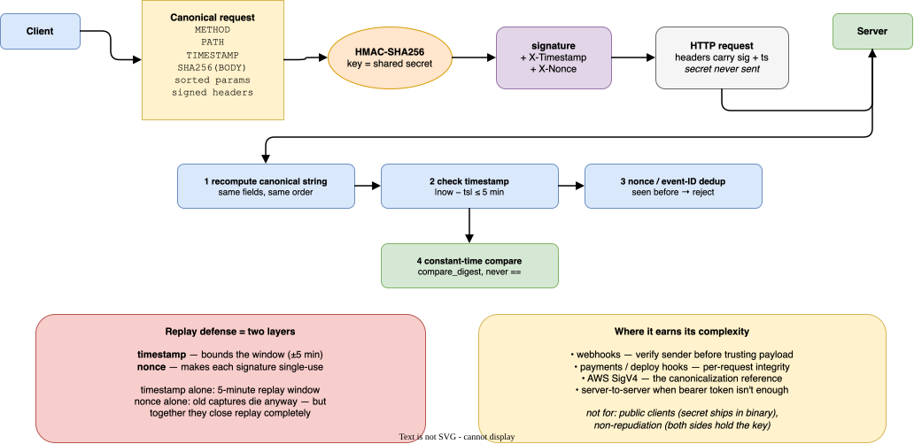

# Request Signing (HMAC & Webhook Verification)

## What it is

Request signing proves a request came from a holder of a **shared secret**
and wasn't modified in transit. Instead of sending the secret (like Basic
Auth), the caller computes an **HMAC over a canonical description of the
request** — method, path, timestamp, body hash — and sends only the
signature. The server recomputes the same HMAC and compares.

```
signature = HMAC_SHA256(secret, canonical_request)

canonical_request = METHOD \n PATH \n TIMESTAMP \n SHA256(BODY)
```

Because the secret never crosses the wire, a captured request can't be
decrypted into credentials — and because the timestamp is *inside* the
signature, replaying the capture fails the freshness check.

{ loading=lazy }

*Editable source: `docs/diagrams/request-signing.drawio`*

## The canonical string — where implementations break

The signature is only as strong as what you canonicalize. The string must
be **unambiguous and identical** on both sides:

| Include | Why |
| --- | --- |
| HTTP method + path | Prevents reusing a `GET` signature for `DELETE` |
| Timestamp (or nonce) | Freshness — bound the replay window to ~5 min |
| Body hash (SHA-256 hex) | Integrity of the payload |
| Sorted, canonical query params | `?a=1&b=2` vs `?b=2&a=1` must produce one string |
| A fixed header set | Only signed headers are tamper-evident |

```python
# Client side — sign a request
import hashlib, hmac, time

def sign(secret: bytes, method: str, path: str, body: bytes) -> dict:
    ts = str(int(time.time()))
    body_hash = hashlib.sha256(body).hexdigest()
    canonical = f"{method}\n{path}\n{ts}\n{body_hash}"
    sig = hmac.new(secret, canonical.encode(), hashlib.sha256).hexdigest()
    return {"X-Signature": sig, "X-Timestamp": ts}
```

```python
# Server side — verify
def verify(secret: bytes, req, tolerance: int = 300) -> bool:
    ts = req.headers["X-Timestamp"]
    if abs(time.time() - int(ts)) > tolerance:      # replay window
        return False
    canonical = f"{req.method}\n{req.path}\n{ts}\n" \
                f"{hashlib.sha256(req.body).hexdigest()}"
    expected = hmac.new(secret, canonical.encode(), hashlib.sha256).hexdigest()
    return hmac.compare_digest(expected, req.headers["X-Signature"])  # constant-time!
```

!!! warning "Always compare in constant time"
    A normal `==` comparison leaks the signature byte-by-byte through
    timing. Use `hmac.compare_digest` (Python), `MessageDigest.isEqual`
    (Java), `crypto.timingSafeEqual` (Node).

## Webhook verification — the killer use case

Payment providers (Stripe, GitHub, Slack) can't prompt for your password
on every callback, so they sign each delivery with a shared webhook
secret:

```python
# Stripe-style verification
def verify_stripe(payload: bytes, sig_header: str, secret: bytes) -> bool:
    ts, sig = parse(sig_header)          # "t=1492774577,v1=5257a..."
    signed = f"{ts}.".encode() + payload
    expected = hmac.new(secret, signed, hashlib.sha256).hexdigest()
    return (hmac.compare_digest(expected, sig)
            and abs(time.time() - int(ts)) <= 300)
```

Your handler verifies the signature **before parsing the body** — an
unsigned or stale event is discarded unprocessed.

## Replay protection — two layers

| Layer | Mechanism | Window it closes |
| --- | --- | --- |
| **Timestamp** in signature | Reject if `|now - ts| > 5 min` | Old captures replayed later |
| **Nonce / event ID** dedup | Store seen IDs (Redis `SET NX EX`) | Captures replayed *inside* the window |
| **`jti` claim** (if JWT-based) | Same dedup, for signed tokens | Token replay across endpoints |

Without the dedup store, an attacker who sniffs one valid request can
replay it for five minutes — fine for `GET /status`, fatal for
`POST /payout`.

## Request signing vs. the alternatives

| | Bearer token / API key | Request signing (HMAC) | [mTLS](mtls.md) |
| --- | --- | --- | --- |
| Secret on the wire? | Yes — the credential itself | No — only the signature | No — key proven via handshake |
| Body integrity? | No | Yes — body hash is signed | No — TLS covers transit only |
| Replay protection | None inherent | Timestamp + nonce | TLS-level |
| Caller secret strength | Must be high-entropy, stored | High-entropy, stored | Private key, ideally in hardware |
| Effort | Minimal | Canonicalization is fiddly | Cert lifecycle machinery |

!!! info "AWS SigV4 is the canonicalization reference"
    AWS Signature Version 4 is the most battle-tested public request-
    signing scheme — every S3 request is a signed canonical request with
    scope `date/region/service/aws4_request`. If you're designing a
    scheme, read it first; its edge cases (URI normalization, header
    folding, chunked bodies) are years of lessons.

## Strengths & weaknesses

| Strengths | Weaknesses |
| --- | --- |
| Secret never transmitted — sniffing yields only a signature | Shared secret on both ends — same blast radius as a leaked key |
| Per-request integrity: body, method, path all tamper-evident | Canonicalization bugs — the #1 cause of interop failures |
| Timestamp+nonce makes replay practical to defeat | Doesn't authenticate *who you are* to a third party — only key holders |
| Works over plain HTTP if needed (though use TLS anyway) | Server must have the exact raw body — proxies that re-encode break it |

## Common attacks & mitigations

| Attack | Mechanism | Mitigation |
| --- | --- | --- |
| **Replay** | Capture a valid request, resend it | Timestamp window + nonce/event-ID dedup |
| **Tamper-evidence gap** | Attacker modifies an *unsigned* part of the request | Sign every security-relevant element — headers, params, body |
| **Timing oracle** | `==` comparison leaks correct prefix | `compare_digest` / `timingSafeEqual` |
| **Weak secret** | HMAC is only as strong as the key | ≥256-bit CSPRNG secrets, stored in a secrets manager |
| **Algorithm downgrade** | Accepting `sha1` or `md5` signatures | Pin the algorithm server-side |
| **Body normalization** | Proxy re-serializes JSON → signature invalid | Sign the *raw* bytes; document canonicalization precisely |

## When to use / avoid

!!! success "Use it for"
    - Webhook receivers — verify the sender before you trust the payload
    - Server-to-server APIs where request integrity matters (payments,
      deployment hooks, internal RPC)
    - Cases where you can't do mTLS but want more than a bearer token
    - Cloud-service-style signing (SigV4 pattern) for partner integrations

!!! failure "Avoid it for"
    - Browser/mobile public clients — the secret ships in the binary and
      is extractable; use OAuth/PKCE
    - Simple internal calls where a bearer token over TLS suffices —
      don't add canonicalization for no benefit
    - Anything needing non-repudiation — HMAC proves "a key holder,"
      not a specific party (both sides hold the key); use asymmetric
      signatures (JWS, ed25519) if a third party must verify

## Checklist

- [x] Secret ≥256 bits, CSPRNG-generated, in a secrets manager
- [x] Canonical string covers method, path, timestamp, body hash, and
      security-relevant headers/params
- [x] Timestamp inside the signature; server rejects >5 min skew
- [x] Nonce or event-ID dedup for replay within the window
- [x] `compare_digest` / `timingSafeEqual` — never `==`
- [x] Algorithm pinned server-side; no client-chosen `alg`
- [x] Raw body used for hashing — before any parsing or normalization
- [x] Signature verification happens before business logic runs
