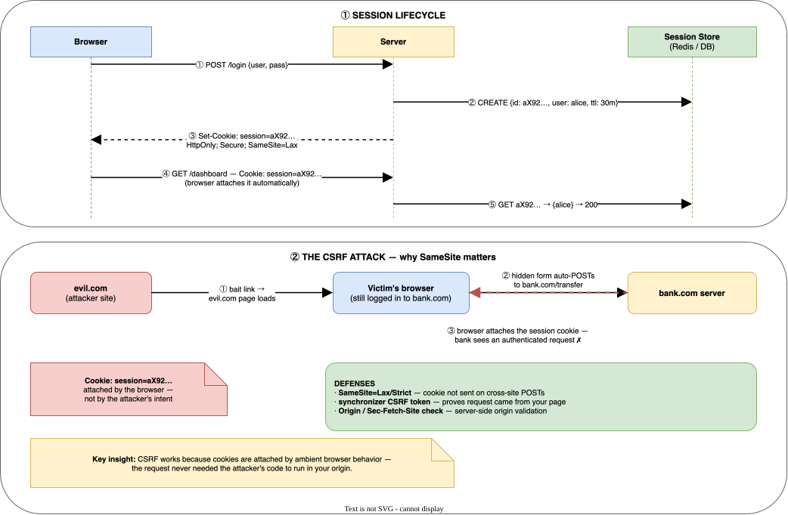

# Session Authentication

## What it is

Session authentication is the original web scheme: after login the server
creates a **server-side session** (a record in memory/Redis/database) and
hands the browser a **session ID cookie**. Every subsequent request carries
the cookie automatically; the server looks up the session to identify the
user.

{ loading=lazy }

*Editable source: `docs/diagrams/session-csrf.drawio`*

## Cookie attributes — the security surface

| Attribute | Effect | Set it? |
| --- | --- | --- |
| `HttpOnly` | JavaScript **cannot** read the cookie — blocks XSS theft | Always |
| `Secure` | Cookie sent over HTTPS only | Always (except `localhost` dev) |
| `SameSite=Lax` | Not sent on cross-site POSTs — kills most CSRF | Default choice |
| `SameSite=Strict` | Not sent on *any* cross-site navigation | High-security apps (breaks some UX) |
| `SameSite=None` | Sent cross-site — **requires** `Secure` | Only for legitimate cross-site embeds |
| `Path=/` | Which paths the cookie applies to | Usually `/` |
| `Domain` | Which hosts get the cookie | Omit (defaults to host-only — safest) |
| `Max-Age` / `Expires` | Cookie lifetime | Keep short; server-side TTL is what really counts |

```http
Set-Cookie: session=aX92b3..; HttpOnly; Secure; SameSite=Lax; Path=/; Max-Age=1800
```

!!! warning "Client-side sessions are not sessions"
    Some frameworks (Flask's default) store the *whole session payload* in
    the cookie, signed but readable. That's a cookie-backed token — it can't
    be revoked server-side and leaks whatever you put in it. Prefer
    server-side stores for anything sensitive.

## Reference implementation

=== "Python (Flask + server-side store)"

    ```python
    import redis
    from flask import Flask, request, session
    from flask_session import Session   # server-side sessions

    app = Flask(__name__)
    app.config.update(
        SECRET_KEY=os.environ["FLASK_SECRET"],
        SESSION_TYPE="redis",                    # store in Redis, not cookie
        SESSION_REDIS=redis.Redis(),
        SESSION_COOKIE_HTTPONLY=True,
        SESSION_COOKIE_SECURE=True,              # HTTPS only
        SESSION_COOKIE_SAMESITE="Lax",
        PERMANENT_SESSION_LIFETIME=1800,         # 30 min TTL
    )
    Session(app)

    @app.post("/login")
    def login():
        if not verify(request.form["user"], request.form["pass"]):
            return "unauthorized", 401
        session.clear()              # (1) kill any pre-login session
        session["user"] = request.form["user"]
        return "ok"

    @app.post("/logout")
    def logout():
        session.clear()              # destroys server-side record
        return "ok"
    ```

    1. `session.clear()` before issuing the authenticated session prevents
       **session fixation** — an attacker can't pre-plant a known session ID.

=== "Java (Spring Session + Redis)"

    ```java
    @Configuration
    @EnableRedisHttpSession(maxInactiveIntervalInSeconds = 1800)
    public class SessionConfig {

        @Bean
        CookieSerializer cookieSerializer() {
            DefaultCookieSerializer s = new DefaultCookieSerializer();
            s.setCookieName("SESSION");
            s.setUseHttpOnlyCookie(true);
            s.setUseSecureCookie(true);
            s.setSameSite("Lax");
            return s;
        }
    }
    ```

    ```java
    @PostMapping("/login")
    ResponseEntity<?> login(@RequestBody Login creds, HttpServletRequest req) {
        if (!authService.verify(creds)) return ResponseEntity.status(401).build();
        req.changeSessionId();          // rotate ID on login — anti-fixation
        req.getSession().setAttribute("user", creds.username());
        return ResponseEntity.ok().build();
    }
    ```

=== "CSRF protection (Flask example)"

    ```python
    from flask_wtf.csrf import CSRFProtect
    CSRFProtect(app)   # rejects state-changing requests without the token
    ```

## Strengths & weaknesses

| Strengths | Weaknesses |
| --- | --- |
| Instant revocation — delete the session record | Stateful — needs a shared store to scale horizontally |
| Cookies handled by browsers automatically | CSRF exposure — cookies are sent on *any* site's requests |
| Server controls session lifecycle fully | Cookie theft via XSS (mitigated by `HttpOnly`) or sniffing (`Secure`) |
| Mature — decades of framework support | Poor fit for mobile apps / non-browser clients |
| No tokens in JavaScript by default | Sticky sessions or shared Redis add infrastructure cost |

## Common attacks & mitigations

| Attack | Mechanism | Mitigation |
| --- | --- | --- |
| **CSRF** | Attacker's page submits a form to your API; browser auto-attaches the session cookie | `SameSite=Lax`+CSRF tokens; reject requests without proper `Origin` |
| **Session fixation** | Attacker forces victim to log in with attacker-chosen session ID | Rotate session ID at login (`changeSessionId`, `session.clear()`) |
| **Session hijacking** | ID stolen via XSS or network sniffing | `HttpOnly`, `Secure`, short TTLs, IP/UA anomaly detection |
| **XSS → payload access** | Any XSS in your app can act *as* the user's session even with `HttpOnly` | CSP, output encoding, XSS discipline — `HttpOnly` stops theft, not abuse |
| **Session replay at scale** | Shared session store breached → all active sessions compromised | Encrypt session data at rest; short TTLs limit the window |

## CSRF deserves special emphasis

Cookies are the only credential type in this guide that browsers attach
**automatically** — including to requests *your app never made*. A hidden
form on `evil.com` can POST to `yourbank.com/transfer` carrying the
victim's session. This is why session auth is the only scheme that *requires*
a second layer (CSRF tokens or strict `SameSite`) for state-changing
requests — bearer tokens and JWTs in headers don't have this problem.

## When to use / avoid

!!! success "Use it for"
    - Server-rendered web apps (Django, Rails, Spring MVC, Laravel)
    - First-party browser apps where you control frontend + backend
    - Anywhere instant revocation matters (admin consoles, banking)

!!! failure "Avoid it for"
    - Mobile/native apps — cookies are awkward; use OAuth/OIDC
    - Cross-domain APIs / third-party consumers — cookies don't travel well
    - Serverless/massively distributed APIs where shared state is costly

## Checklist

- [x] `HttpOnly`, `Secure`, `SameSite=Lax` (or `Strict`) on every cookie
- [x] Server-side session store (Redis/DB), not cookie-stuffed payloads
- [x] Session ID rotated on login; destroyed on logout
- [x] Server-side TTL ≤ 30 min of inactivity for sensitive apps
- [x] CSRF tokens or strict `SameSite` + `Origin` checks on mutations
- [x] Session IDs ≥128 bits from a CSPRNG (framework defaults qualify —
      don't roll your own generator)
