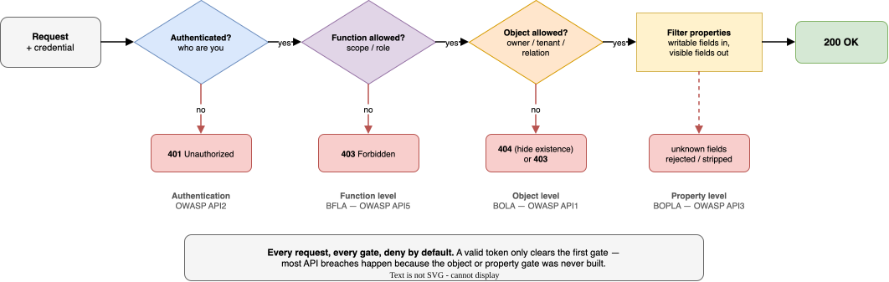

# Authorization

Authentication proves **who** the caller is. Authorization decides **what
that caller may do** — on *this* endpoint, to *this* object, right now. It
runs on every request, after authentication succeeds, and it's where most
real-world API breaches happen: Broken Object Level Authorization is #1
on the [OWASP API Security Top 10](https://owasp.org/API-Security/editions/2023/en/0x11-t10/),
and broken function- and property-level authorization are #5 and #3.

{ loading=lazy }

*Editable source: `docs/diagrams/authz-decision-flow.drawio`*

!!! info "401 vs. 403"
    **401 Unauthorized** means *authentication* failed — "I don't know who
    you are." **403 Forbidden** means *authorization* failed — "I know who
    you are, and the answer is no." Returning **404** for objects the caller
    can't see is a legitimate choice that avoids confirming the object
    exists.

## How this section is organized

Each page follows the same structure:

1. **What it is** — the concept and the governing standard, if any
2. **How it works** — the decision flow and data model
3. **Reference implementation** — working code in Python and Java
4. **Common mistakes & mitigations** — what goes wrong in production
5. **When to use / avoid** — decision guidance
6. **Checklist** — what to verify in review

| Page | One-line summary |
| --- | --- |
| [Access-Control Models](models.md) | ACL, RBAC, ABAC, ReBAC — how permissions are expressed |
| [Scopes & Claims](scopes-claims.md) | Carrying authorization data in OAuth scopes and JWT claims — and its limits |
| [Object & Function Level](object-level.md) | BOLA, BFLA, BOPLA — the OWASP API Top 10 authorization failures |
| [Policy Engines & Enforcement](policy-engines.md) | PEP/PDP architecture, OPA, Cedar, OpenFGA; gateway vs. service checks |
| [Multi-Tenancy & Delegation](multi-tenancy.md) | Tenant isolation, row-level security, impersonation, service identities |
| [Testing & Pitfalls](testing.md) | How to prove authorization works and the anti-patterns that break it |
| [Worked Example: RBAC API](rbac-design.md) | Admin / manager / user on the same endpoints — permission matrix to tested code |

## The authorization golden rules

1. **Deny by default.** Every endpoint is closed until a rule opens it. A
   missing check must fail closed, not open.
2. **Check on the server, on every request.** Hiding a button in the UI is
   not authorization.
3. **Check the object, not just the endpoint.** "May call `GET /orders/{id}`"
   and "may read order 42" are different questions.
4. **Derive identity from the credential, never the request body.** The
   `user_id` in a JSON payload is attacker-controlled; the `sub` in a
   verified token is not.
5. **Centralize the decision, enforce it everywhere.** One policy, applied
   consistently, beats a hundred hand-written `if` statements.
6. **Least privilege.** Grant the narrowest role, scope, and lifetime that
   does the job.
