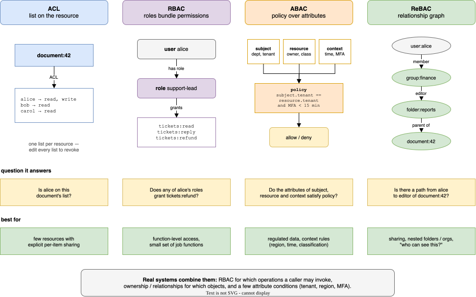

# Access-Control Models

## What it is

An access-control model is the vocabulary you use to express *who may do
what to which resource*. The model determines what questions your system
can answer cheaply — and which ones become a tangle of special cases.

| Model | Decision is based on | Typical question | Reference |
| --- | --- | --- | --- |
| **ACL** | A list attached to each resource | "Is Alice on this file's list?" | POSIX, cloud storage ACLs |
| **RBAC** | Roles assigned to subjects; permissions assigned to roles | "Does any of Alice's roles grant `orders:refund`?" | NIST RBAC model (INCITS 359) |
| **ABAC** | Attributes of subject, resource, action, and environment | "Is Alice in the same region as the record, during business hours?" | [NIST SP 800-162](https://csrc.nist.gov/pubs/sp/800/162/upd2/final) |
| **ReBAC** | Relationships in a graph between subjects and objects | "Is Alice an editor of a folder that contains this document?" | [Google Zanzibar](https://www.usenix.org/conference/atc19/presentation/pang) |

{ loading=lazy }

*Editable source: `docs/diagrams/access-control-models.drawio`*

These aren't mutually exclusive. Most production systems use **RBAC for
coarse function access** plus **ownership/relationship checks for objects**
plus a few **attribute conditions** (tenant, region, time).

## How it works

### ACL — Access Control Lists

Each resource stores the principals allowed to act on it.

```text
document:42  →  [(alice, read), (alice, write), (bob, read)]
```

Simple and precise, but it doesn't scale administratively: "remove Bob from
everything in the finance department" means touching every list.

### RBAC — Role-Based Access Control

Permissions attach to **roles**; users get roles. The check becomes
"does the user hold a role that grants this permission?"

```text
user ──< user_roles >── role ──< role_permissions >── permission
alice                   support-agent                 tickets:read
                                                      tickets:reply
bob                     support-lead  (inherits agent) tickets:refund
```

Good for function-level access ("who may call the refund endpoint?"). On
its own it can't express **"only *your own* tickets"** — that needs an
ownership or relationship check layered on top. See the
[RBAC worked example](rbac-design.md) for a full admin / manager / user
design.

!!! warning "Role explosion"
    When you start creating `support-agent-emea-readonly-tier2`, you are
    encoding attributes into role names. That's the signal to move those
    dimensions into ABAC conditions or relationships.

### ABAC — Attribute-Based Access Control

A policy evaluates attributes at request time:

- **Subject**: department, clearance, tenant, employment status
- **Resource**: owner, classification, tenant, region
- **Action**: read, update, approve
- **Environment**: time, source network, device posture, MFA freshness

```text
permit if subject.tenant == resource.tenant
       and action == "read"
       and (resource.classification != "phi" or subject.hipaa_trained)
```

Expressive and context-aware, but harder to audit: "who can read record 42?"
requires evaluating the policy against every subject.

### ReBAC — Relationship-Based Access Control

Permissions derive from a graph of relationships — popularized by Google's
Zanzibar and implemented by OpenFGA, SpiceDB, and others.

```text
document:42#parent@folder:finance
folder:finance#editor@group:finance-team#member
group:finance-team#member@user:alice
```

→ Alice is an editor of document 42 through the folder and group. ReBAC
excels at sharing, hierarchies, and "who can see this?" queries — the
things that make Google Docs-style permissions hard in RBAC.

## Reference implementation

RBAC for the function check, ownership for the object check:

=== "Python (FastAPI)"

    ```python
    from fastapi import Depends, FastAPI, HTTPException

    app = FastAPI()

    ROLE_PERMISSIONS = {
        "support-agent": {"tickets:read", "tickets:reply"},
        "support-lead":  {"tickets:read", "tickets:reply", "tickets:refund"},
    }

    def require(permission: str):
        def checker(user: dict = Depends(current_user)):  # from authentication
            granted = set().union(*(ROLE_PERMISSIONS.get(r, set())
                                    for r in user["roles"]))
            if permission not in granted:
                raise HTTPException(403, "Forbidden")
            return user
        return checker

    @app.post("/tickets/{ticket_id}/refund")
    def refund(ticket_id: int, user: dict = Depends(require("tickets:refund"))):
        ticket = tickets.get(ticket_id)
        if ticket is None or ticket.tenant_id != user["tenant_id"]:
            raise HTTPException(404)             # object-level check
        ...
    ```

=== "Java (Spring Security)"

    ```java
    @Configuration
    @EnableMethodSecurity
    public class SecurityConfig { /* role → authority mapping via
                                     RoleHierarchy, deny by default */ }

    @RestController
    class TicketController {

        @PostMapping("/tickets/{id}/refund")
        @PreAuthorize("hasAuthority('tickets:refund')")      // function-level
        public ResponseEntity<?> refund(@PathVariable long id,
                                        @AuthenticationPrincipal AppUser user) {
            Ticket t = repo.findByIdAndTenantId(id, user.tenantId()) // object-level
                           .orElseThrow(NotFoundException::new);
            ...
        }
    }
    ```

=== "ReBAC (OpenFGA model)"

    ```text
    model
      schema 1.1

    type user

    type group
      relations
        define member: [user]

    type folder
      relations
        define editor: [user, group#member]
        define viewer: [user, group#member] or editor

    type document
      relations
        define parent: [folder]
        define editor: [user] or editor from parent
        define viewer: [user] or editor or viewer from parent
    ```

## Common mistakes & mitigations

| Mistake | Detail | Mitigation |
| --- | --- | --- |
| Checking roles, not permissions | `if role == "admin"` scattered across code; adding a role means editing every check | Check *permissions*; map roles → permissions in one place |
| Role explosion | Hundreds of near-duplicate roles encoding region/tier/tenant | Move those dimensions into attributes or relationships |
| RBAC used for object access | "Has `orders:read`" treated as "may read *any* order" | Always add an ownership/tenant/relationship check for objects |
| Stale role data in tokens | Role removed in the IdP, still present in a 24-hour JWT | Short token TTLs; look up volatile permissions server-side |
| Unauditable ABAC | Nobody can answer "who can see X?" | Keep policies declarative, versioned, and testable (see [Policy Engines](policy-engines.md)) |

## When to use / avoid

!!! success "Pick"
    - **RBAC** — internal tools, admin consoles, function-level access with a
      small, stable set of job functions
    - **ABAC** — regulated data, context-dependent rules (region, time,
      classification, device posture)
    - **ReBAC** — user-to-user sharing, nested folders/orgs/projects,
      "who has access to this?" queries at scale
    - **ACL** — a small number of resources with explicit, per-item sharing

!!! failure "Avoid"
    - RBAC alone for any API that returns user-owned data
    - ABAC with policies hand-coded in application `if` statements
    - Building your own ReBAC graph engine — use OpenFGA, SpiceDB, or similar

## Checklist

- [x] A single, documented mapping of roles → permissions
- [x] Code checks permissions, not role names
- [x] Every object-returning endpoint has an ownership/tenant/relationship check
- [x] Deny-by-default for unknown roles, actions, and resources
- [x] Role and permission changes take effect within a bounded time
- [x] Periodic access reviews remove unused roles and grants
