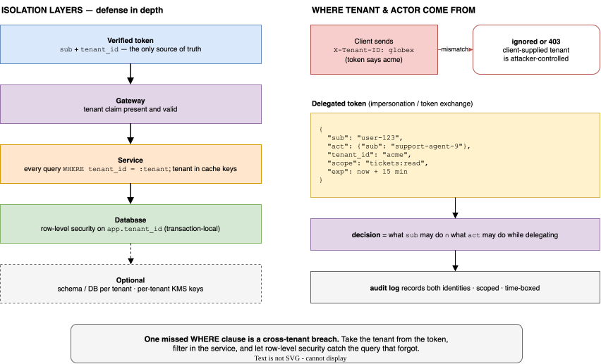

# Multi-Tenancy & Delegation

## What it is

**Multi-tenancy** means one API serves many customers (tenants) whose data
must never cross. **Delegation** means one identity acts on behalf of
another — a support agent impersonating a user, a service calling another
service for a user, or a third-party app acting with the user's consent.
Both are authorization problems where a single missed check exposes
*someone else's* data.

## How it works

### Tenant isolation layers

{ loading=lazy }

*Editable source: `docs/diagrams/tenant-isolation.drawio`*

| Isolation level | How | Trade-off |
| --- | --- | --- |
| **Shared tables + `tenant_id` column** | Every query filters by tenant | Cheapest; one missed `WHERE` is a cross-tenant breach |
| **Shared tables + row-level security** | Database enforces the filter | Defense in depth; requires session-level tenant context |
| **Schema / database per tenant** | Connection routed by tenant | Stronger isolation; more operational overhead |
| **Per-tenant encryption keys** | Data encrypted with tenant-specific KMS keys | Crypto-shredding on offboarding; key-management cost |

!!! danger "Tenant comes from the token, never from the request"
    `X-Tenant-ID: acme` in a header or `?tenant=acme` in a query string is
    attacker-controlled. Derive the tenant from the verified token (or from
    a server-side lookup of the authenticated user) and ignore any
    client-supplied value — or reject the request if they disagree.

### Database-enforced isolation

PostgreSQL row-level security makes the database refuse cross-tenant rows
even if application code forgets the filter:

```sql
ALTER TABLE invoices ENABLE ROW LEVEL SECURITY;
ALTER TABLE invoices FORCE ROW LEVEL SECURITY;   -- applies to the table owner too

CREATE POLICY tenant_isolation ON invoices
    USING (tenant_id = current_setting('app.tenant_id')::uuid)
    WITH CHECK (tenant_id = current_setting('app.tenant_id')::uuid);
```

The application sets the tenant per transaction from the verified token:

=== "Python (SQLAlchemy)"

    ```python
    from sqlalchemy import text

    def tenant_session(claims: dict):
        with SessionLocal() as db, db.begin():
            db.execute(text("SELECT set_config('app.tenant_id', :t, true)"),
                       {"t": claims["tenant"]})   # true = transaction-local
            yield db
    ```

=== "Java (Spring + JdbcTemplate)"

    ```java
    @Transactional
    public List<Invoice> listInvoices(Jwt jwt) {
        jdbc.queryForObject("SELECT set_config('app.tenant_id', ?, true)",
                            String.class, jwt.getClaimAsString("tenant"));
        return jdbc.query("SELECT * FROM invoices", invoiceMapper); // RLS filters
    }
    ```

!!! warning "Connection pools and superusers"
    Use transaction-local settings (`set_config(..., true)` / `SET LOCAL`)
    so a pooled connection never carries the previous request's tenant.
    Application roles must not be superusers or have `BYPASSRLS`.

### Delegation patterns

| Pattern | Use | Required controls |
| --- | --- | --- |
| **OAuth consent** | Third-party app acts for a user | Scopes, consent screen, revocable grants |
| **Token exchange** ([RFC 8693](https://www.rfc-editor.org/rfc/rfc8693)) | Service A calls service B on behalf of a user | New token with narrower scope/audience; `act` claim names the actor |
| **Impersonation** | Support/admin "log in as" a user | Separate permission, reason required, time-boxed, visible to the user, fully audited |
| **Service accounts** | Batch jobs and service-to-service calls with no user | Own identity, least privilege, short-lived credentials (workload identity), no shared human accounts |

A delegated token should always record **both** identities:

```json
{
  "sub": "user-123",
  "act": { "sub": "support-agent-9" },
  "scope": "tickets:read",
  "exp": 1731958400
}
```

Authorization decisions use the *intersection* of what the subject may do
and what the actor is allowed to do while delegating — and audit logs record
both.

## Common mistakes & mitigations

| Mistake | Detail | Mitigation |
| --- | --- | --- |
| Tenant from header or path | `/tenants/{id}/...` trusted without comparing to the token | Derive tenant from the token; reject mismatches |
| One missed `WHERE tenant_id` | A new report query returns every tenant's data | Row-level security, repository base classes that require tenant |
| Cross-tenant caches | Cache key is `invoice:42`, not `tenant:acme:invoice:42` | Include tenant (and subject, when relevant) in every cache key |
| Background jobs without context | Workers process jobs with no tenant set, so RLS is bypassed or broken | Carry tenant in the job payload and set it before any query |
| Impersonation with full power | "Log in as" grants everything, leaves no trace | Scoped, time-limited impersonation tokens with `act` and audit |
| Shared service account | Many services share one powerful credential | One identity per workload, least privilege, short-lived tokens |
| Search indexes and exports | Elasticsearch/BigQuery copies lose tenant filters | Apply tenant filters (or separate indexes) in every derived store |

## When to use / avoid

!!! success "Use"
    - Row-level security for any shared-table multi-tenant system
    - Token exchange for any downstream call made on a user's behalf
    - Dedicated, audited impersonation flows for support tooling

!!! failure "Avoid"
    - Client-supplied tenant identifiers as the source of truth
    - Forwarding end-user tokens unchanged to internal services
    - Long-lived, shared service-account keys

## Checklist

- [x] Tenant derived from the verified token on every request
- [x] All queries tenant-scoped; row-level security as a backstop
- [x] Cache keys, search indexes, and exports include tenant
- [x] Background jobs carry and set tenant context
- [x] Delegated tokens carry an `act` claim; audit logs record both identities
- [x] Impersonation requires a dedicated permission, a reason, and expires
- [x] Each workload has its own least-privilege identity
