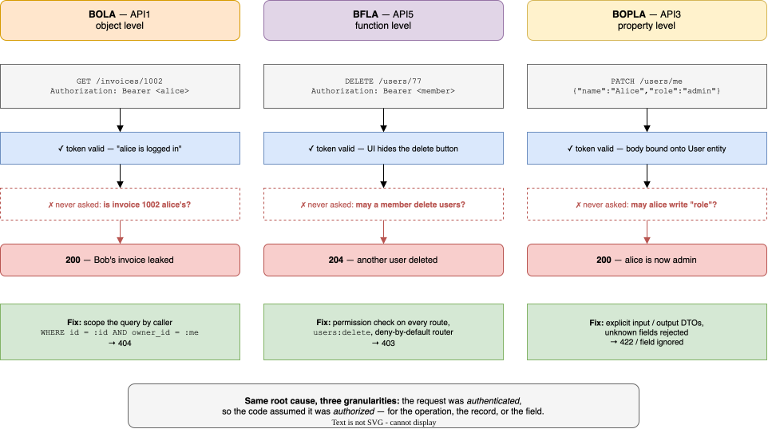

# Object, Function & Property Level Authorization

## What it is

Three of the [OWASP API Security Top 10 (2023)](https://owasp.org/API-Security/editions/2023/en/0x11-t10/)
are authorization failures at different granularities:

| OWASP | Name | The question that was skipped |
| --- | --- | --- |
| [API1](https://owasp.org/API-Security/editions/2023/en/0xa1-broken-object-level-authorization/) | **BOLA** — Broken Object Level Authorization (a.k.a. IDOR) | "May this caller access *this specific record*?" |
| [API3](https://owasp.org/API-Security/editions/2023/en/0xa3-broken-object-property-level-authorization/) | **BOPLA** — Broken Object Property Level Authorization | "May this caller read/write *this field* of the record?" |
| [API5](https://owasp.org/API-Security/editions/2023/en/0xa5-broken-function-level-authorization/) | **BFLA** — Broken Function Level Authorization | "May this caller invoke *this operation* at all?" |

All three share a root cause: the request was **authenticated**, so the
code assumed it was **authorized**.

{ loading=lazy }

*Editable source: `docs/diagrams/bola-bfla-bopla.drawio`*

## How it works

### BOLA — the #1 API vulnerability

```http
GET /api/invoices/1001 HTTP/1.1        ← Alice's invoice
Authorization: Bearer <alice-token>

GET /api/invoices/1002 HTTP/1.1        ← Bob's invoice. Same token.
Authorization: Bearer <alice-token>
```

If the second request returns 200, the API checked "is this a valid user?"
and never asked "is this *Alice's* invoice?" Random UUIDs make IDs harder to
guess but **do not fix BOLA** — IDs leak through URLs, logs, shared links,
and other API responses.

### BFLA — hidden admin endpoints

```http
DELETE /api/users/77 HTTP/1.1
Authorization: Bearer <regular-user-token>
```

The admin UI never shows a delete button to regular users, but the endpoint
itself doesn't check the role. Attackers find these by reading JavaScript
bundles, OpenAPI specs, or guessing REST conventions (`GET` works → try
`PUT`/`DELETE`).

### BOPLA — mass assignment and over-exposure

=== "Write: mass assignment"

    ```http
    PATCH /api/users/me HTTP/1.1
    Content-Type: application/json

    {"display_name": "Alice", "role": "admin", "credit_balance": 99999}
    ```

    The handler binds the whole body onto the user model, so the caller
    sets fields they should never control.

=== "Read: excessive data exposure"

    ```json
    {
      "id": 42,
      "display_name": "Alice",
      "email": "alice@example.com",
      "password_hash": "$argon2id$...",
      "ssn_last4": "1234",
      "internal_risk_score": 0.87
    }
    ```

    The API serializes the database row and trusts the client to hide
    fields. Every field in the response is visible to the caller.

## Reference implementation

The pattern: **scope the query by the caller's identity**, and use
**explicit input/output schemas** per role.

=== "Python (FastAPI + SQLAlchemy)"

    ```python
    from fastapi import Depends, FastAPI, HTTPException
    from pydantic import BaseModel, ConfigDict
    from sqlalchemy import select

    app = FastAPI()

    class InvoiceOut(BaseModel):          # explicit output — no internal fields
        id: int
        amount: int
        status: str

    class ProfileIn(BaseModel):           # explicit input — no role/balance
        model_config = ConfigDict(extra="forbid")
        display_name: str

    @app.get("/invoices/{invoice_id}", response_model=InvoiceOut)
    def get_invoice(invoice_id: int, user=Depends(current_user), db=Depends(session)):
        invoice = db.scalar(
            select(Invoice).where(Invoice.id == invoice_id,
                                  Invoice.owner_id == user.id))   # BOLA guard
        if invoice is None:
            raise HTTPException(404)
        return invoice

    @app.patch("/users/me")
    def update_profile(body: ProfileIn, user=Depends(current_user), db=Depends(session)):
        user.display_name = body.display_name                   # BOPLA guard
        db.commit()

    @app.delete("/users/{user_id}", dependencies=[Depends(require("users:delete"))])
    def delete_user(user_id: int, db=Depends(session)):          # BFLA guard
        ...
    ```

=== "Java (Spring Boot + JPA)"

    ```java
    public record InvoiceDto(long id, long amount, String status) {}
    public record ProfileUpdate(@NotBlank String displayName) {}

    public interface InvoiceRepository extends JpaRepository<Invoice, Long> {
        Optional<Invoice> findByIdAndOwnerId(long id, long ownerId);  // BOLA guard
    }

    @RestController
    class InvoiceController {

        @GetMapping("/invoices/{id}")
        InvoiceDto get(@PathVariable long id, @AuthenticationPrincipal AppUser me) {
            return repo.findByIdAndOwnerId(id, me.id())
                       .map(i -> new InvoiceDto(i.getId(), i.getAmount(), i.getStatus()))
                       .orElseThrow(NotFoundException::new);
        }

        @PatchMapping("/users/me")
        void update(@Valid @RequestBody ProfileUpdate body,           // BOPLA guard
                    @AuthenticationPrincipal AppUser me) {
            users.updateDisplayName(me.id(), body.displayName());
        }

        @DeleteMapping("/users/{id}")
        @PreAuthorize("hasAuthority('users:delete')")                  // BFLA guard
        void delete(@PathVariable long id) { ... }
    }
    ```

!!! tip "Fetch-then-check vs. query-scoping"
    `find(id)` followed by `if owner != me` works, but it's easy to forget
    on the next endpoint. Scoping the query itself (`WHERE owner_id = :me`
    or a repository method that *requires* the owner) makes the safe path
    the only path. For multi-tenant data, push it further with
    [row-level security](multi-tenancy.md#database-enforced-isolation).

## Common mistakes & mitigations

| Mistake | Detail | Mitigation |
| --- | --- | --- |
| Trusting IDs from the client | `user_id` in body/query used to select records | Take identity from the verified token; scope queries by it |
| "Unguessable IDs" as the control | UUIDs leak via URLs, logs, and other responses | UUIDs are fine as hygiene, never as authorization |
| Checks only on read | `GET` checks ownership, `PUT`/`DELETE` don't | Same object check on every verb; test all of them |
| Nested resources | `/projects/1/tasks/99` checks project 1, but task 99 belongs to project 2 | Verify the child belongs to the parent *and* the parent to the caller |
| Batch & GraphQL endpoints | `ids=[1,2,3]` or a GraphQL node query skips per-object checks | Authorize each object returned, in the resolver/loader layer |
| Binding request bodies to entities | ORMs/`ObjectMapper` set any matching field | Dedicated input DTOs; reject unknown fields |
| Returning entities directly | Internal and sensitive columns serialized | Dedicated output DTOs per audience |
| Admin routes protected by obscurity | `/internal/*`, `/v1/admin/*` reachable from the internet | Function-level checks on every route; deny-by-default router |

## When to use

!!! success "Apply to every endpoint that"
    - Takes an object identifier from the path, query, body, or header
    - Returns or modifies data that belongs to a user, team, or tenant
    - Performs an operation not every authenticated user should perform

There is no "avoid" case — this is the baseline for any API that serves
more than one user.

## Checklist

- [x] Every object lookup is scoped by the caller's identity or tenant
- [x] Object checks apply to all HTTP verbs and to batch/GraphQL paths
- [x] Child resources are verified against their parent
- [x] Request bodies bind to explicit input DTOs; unknown fields rejected
- [x] Responses use explicit output DTOs; no raw entity serialization
- [x] Every route has a function-level check; unmatched routes are denied
- [x] Automated tests exercise each endpoint with a second user's token (see [Testing](testing.md))
