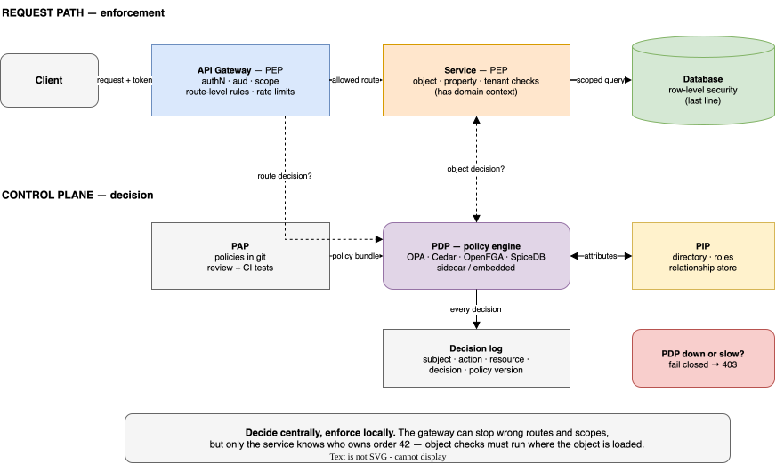

# Policy Engines & Enforcement

## What it is

As authorization rules grow, scattering `if` statements across services
makes them impossible to audit or change consistently. The standard
architecture — formalized in [XACML](https://docs.oasis-open.org/xacml/3.0/xacml-3.0-core-spec-os-en.html)
and NIST SP 800-162 — separates *deciding* from *enforcing*:

| Component | Role | Example |
| --- | --- | --- |
| **PEP** — Policy Enforcement Point | Intercepts the request, asks for a decision, enforces it | API gateway, middleware, service mesh sidecar |
| **PDP** — Policy Decision Point | Evaluates policy and returns allow/deny | OPA, Cedar, OpenFGA, SpiceDB |
| **PIP** — Policy Information Point | Supplies extra attributes the PDP needs | User directory, resource DB, relationship store |
| **PAP** — Policy Administration Point | Where policies are written, reviewed, and versioned | Git repo + CI, admin UI |

## How it works

{ loading=lazy }

*Editable source: `docs/diagrams/pep-pdp-architecture.drawio`*

For `DELETE /projects/7`, the PEP authenticates the caller and sends
`{subject, action: "delete", resource: "project:7"}` to the PDP. The PDP
asks the PIP who owns project 7 and which roles the subject holds, then
returns allow or deny. On deny the PEP returns 403; on allow the request
proceeds to service logic.

## Where to enforce: gateway vs. service

| Layer | Good at | Can't do |
| --- | --- | --- |
| **API gateway / edge** | Authentication, audience and scope checks, coarse route-level rules, rate limits | Object-level checks — it doesn't know who owns order 42 |
| **Service mesh** | Service-to-service identity (mTLS/SPIFFE), "may service A call service B?" | User- or object-level decisions |
| **Service middleware / handler** | Object, property, and tenant checks with full domain context | Consistency across many services — unless it calls a shared PDP |
| **Database** | Last-line tenant/row isolation (row-level security) | Rich business rules |

!!! warning "The gateway is not enough"
    A gateway that checks `scope=orders:read` stops *function-level* abuse.
    It cannot stop BOLA. Object-level checks must run where the object is
    loaded — inside the service — even if the decision is delegated to a
    shared PDP.

## Engine landscape

| Engine | Model | Policy language | Notes |
| --- | --- | --- | --- |
| [Open Policy Agent](https://www.openpolicyagent.org/) | ABAC / general purpose | Rego | CNCF graduated; used for APIs, Kubernetes admission, Terraform |
| [Cedar](https://www.cedarpolicy.com/) | RBAC + ABAC | Cedar | Designed for analyzability; used by Amazon Verified Permissions |
| [OpenFGA](https://openfga.dev/) | ReBAC (Zanzibar-style) | FGA DSL + relationship tuples | CNCF project; strong for sharing and hierarchies |
| [SpiceDB](https://authzed.com/spicedb) | ReBAC (Zanzibar-style) | SpiceDB schema | Consistency tokens ("zookies") to avoid stale reads |
| Framework built-ins | RBAC / expressions | Spring `@PreAuthorize`, Django permissions, Casbin | Fine for a single service; harder to share across many |

## Reference implementation

=== "OPA (Rego policy)"

    ```rego
    package httpapi.authz

    default allow := false

    # Any authenticated user may read their own projects
    allow if {
        input.action == "read"
        input.resource.owner == input.subject.id
    }

    # Project admins may delete — within their own tenant only
    allow if {
        input.action == "delete"
        "project-admin" in input.subject.roles
        input.resource.tenant == input.subject.tenant
    }
    ```

=== "Cedar policy"

    ```cedar
    permit (
        principal,
        action == Action::"read",
        resource is Project
    ) when { resource.owner == principal };

    permit (
        principal in Role::"project-admin",
        action == Action::"delete",
        resource is Project
    ) when { resource.tenant == principal.tenant };

    forbid (principal, action, resource)
    when { resource.legal_hold == true && action == Action::"delete" };
    ```

=== "Python PEP calling OPA"

    ```python
    import httpx
    from fastapi import HTTPException

    OPA_URL = "http://localhost:8181/v1/data/httpapi/authz/allow"

    def authorize(subject: dict, action: str, resource: dict) -> None:
        try:
            r = httpx.post(OPA_URL, timeout=0.5, json={"input": {
                "subject": subject, "action": action, "resource": resource}})
            r.raise_for_status()
            allowed = r.json().get("result", False)
        except httpx.HTTPError:
            allowed = False                      # fail closed
        if not allowed:
            raise HTTPException(403, "Forbidden")
    ```

=== "Java PEP calling OPA"

    ```java
    @Component
    public class OpaAuthorizer {
        private final RestClient opa = RestClient.builder()
            .baseUrl("http://localhost:8181").build();

        public void authorize(Map<String, Object> input) {
            boolean allowed;
            try {
                Map<?, ?> res = opa.post()
                    .uri("/v1/data/httpapi/authz/allow")
                    .body(Map.of("input", input))
                    .retrieve().body(Map.class);
                allowed = Boolean.TRUE.equals(res == null ? null : res.get("result"));
            } catch (RestClientException e) {
                allowed = false;                     // fail closed
            }
            if (!allowed) throw new AccessDeniedException("Forbidden");
        }
    }
    ```

## Operational concerns

- **Fail closed.** If the PDP is unreachable or times out, deny. An outage
  is better than a breach.
- **Latency.** Run the PDP as a sidecar or embedded library to keep
  decisions in single-digit milliseconds. Cache decisions only with short
  TTLs and never across subjects.
- **Policy as code.** Store policies in git, require review, and run
  policy unit tests in CI (`opa test`, Cedar's validator and analysis
  tooling, OpenFGA model tests).
- **Decision logging.** Log subject, action, resource, decision, and policy
  version for every deny and for sensitive allows. This is your audit
  trail.
- **List filtering.** "Show me every project I can see" can't be done by
  calling the PDP per row on a million rows. Use partial evaluation (OPA),
  `ListObjects`/`LookupResources` (OpenFGA/SpiceDB), or translate the
  policy into a query filter.

## Common mistakes & mitigations

| Mistake | Detail | Mitigation |
| --- | --- | --- |
| Fail-open on PDP errors | `except: allow = True` keeps the site up during an outage — for attackers too | Default deny on timeout, error, or missing result |
| Gateway-only enforcement | Route checks at the edge, no object checks behind it | Object checks inside the service, using the same PDP |
| Policy and data drift | PDP has stale role or relationship data | Event-driven sync, consistency tokens, short caches |
| Untested policies | A refactor silently opens access | Policy unit tests and allow/deny regression suites in CI |
| Leaking policy internals | Detailed deny reasons returned to clients | Generic 403/404 to clients; detailed reason in logs only |

## When to use / avoid

!!! success "Adopt a policy engine when"
    - Several services need the same authorization rules
    - Auditors or security need to review rules without reading app code
    - Rules depend on many attributes or on relationships between objects

!!! failure "Probably overkill when"
    - One service, a handful of roles, and simple ownership checks — a
      well-structured framework guard is enough

## Checklist

- [x] Enforcement happens in the service for object-level decisions
- [x] PDP failures and timeouts result in deny
- [x] Policies live in version control with review and automated tests
- [x] Every decision is logged with the policy version
- [x] List endpoints use partial evaluation or a lookup API, not per-row calls
