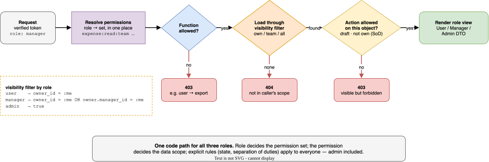
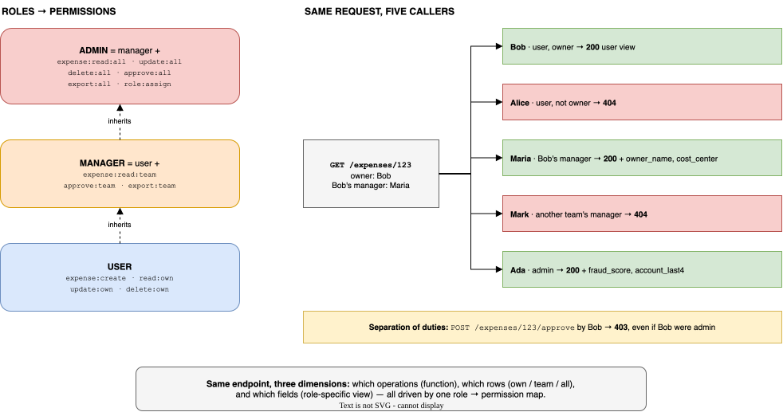

# Worked Example: Designing an RBAC API

A design walkthrough for the classic question:

> *Design an API with role-based access control. The same endpoints must
> behave differently per role — **admin** has full access, **manager** has
> partial access, **user** has limited access.*

The domain is an **expense-report API**. It's small enough to follow but
exercises every authorization layer from
[Object & Function Level](object-level.md): which *operations* a role may
call, which *records* it may see, and which *fields* it may read or write.

## Requirements

| Role | Intent |
| --- | --- |
| **User** (employee) | Submit and manage *their own* expenses |
| **Manager** | Everything a user can do, plus see and approve *their direct reports'* expenses |
| **Admin** (finance) | See and manage *all* expenses, export data, assign roles |

Two extra rules that make the design realistic:

- **Separation of duties** — nobody approves their own expense, not even an
  admin.
- **Edit window** — users and managers can only edit or delete their own
  expenses while they are still `draft`.

## Step 1 — The permission matrix

Write the matrix *before* any code. It is the specification, the review
artifact, and the source of your tests.

| Action | Endpoint | User | Manager | Admin |
| --- | --- | :-: | :-: | :-: |
| List expenses | `GET /expenses` | own | own + team | all |
| View expense | `GET /expenses/{id}` | own | own + team | all |
| Create expense | `POST /expenses` | self | self | self |
| Update expense | `PATCH /expenses/{id}` | own, draft | own, draft | any |
| Delete expense | `DELETE /expenses/{id}` | own, draft | own, draft | any |
| Approve / reject | `POST /expenses/{id}/approve` | ✗ | team, not own | any, not own |
| Export CSV | `GET /expenses/export` | ✗ | team | all |
| Assign roles | `PUT /users/{id}/roles` | ✗ | ✗ | ✓ |

Notice that one row can differ in three independent ways:

1. **Function level**: may the role call the endpoint at all? (export,
   approve, assign roles)
2. **Object level**: *which* rows are in scope? (own / team / all)
3. **Property level**: which fields come back, and which can be written? (see
   [step 4](#step-4-field-level-views))

!!! tip "Same endpoint, not `/admin/expenses`"
    Separate admin routes look simpler, but they duplicate logic, double
    the attack surface, and tend to drift. A single endpoint whose *data
    scope* and *view* depend on the caller's role keeps one code path to
    secure and test.

## Step 2 — Roles → permissions

Code checks **permissions**, never role names. Roles are just named bundles
of permissions, defined in one place. The permission string encodes the
**scope** (`own` / `team` / `all`) so the object-level rule falls straight
out of it.

```text
user     = expense:create
           expense:read:own     expense:update:own     expense:delete:own

manager  = user
         + expense:read:team    expense:approve:team   expense:export:team

admin    = manager
         + expense:read:all     expense:update:all     expense:delete:all
           expense:approve:all  expense:export:all     role:assign
```

!!! warning "A hierarchy is not a free pass"
    `admin ⊇ manager ⊇ user` is convenient, but separation of duties means
    admin is *not* allowed everything: "approve own expense" is denied for
    every role. Keep such rules as explicit checks, not as missing
    permissions you hope nobody grants.

## Step 3 — Scope every query by role

The visibility rule becomes a reusable query filter, so `list`, `get`,
`update`, `delete`, `approve`, and `export` all start from the same set of
visible rows.

{ loading=lazy }

*Editable source: `docs/diagrams/rbac-request-flow.drawio`*

!!! info "404 vs. 403 in this design"
    - Object **not visible** to the caller → **404**. A user probing
      `/expenses/123` learns nothing about whether it exists.
    - Object **visible** but the action is forbidden (approving your own
      expense, editing a submitted one) → **403**. The caller can already
      see the object, so hiding it gains nothing, and a clear 403 helps
      legitimate clients.

## Step 4 — Field-level views

Each role gets an explicit response schema. Fields that aren't in the
schema can't leak, whatever gets added to the database later.

| Field | User | Manager | Admin |
| --- | :-: | :-: | :-: |
| `id`, `amount`, `currency`, `description`, `status`, `submitted_at` | ✓ | ✓ | ✓ |
| `owner_name`, `cost_center`, `approver_comment` | – | ✓ | ✓ |
| `reimbursement_account_last4`, `fraud_score`, `audit_log` | – | – | ✓ |

The same rule applies to writes: `owner_id`, `status`, and `approved_by` are
**never** accepted from the request body. The server sets them.

## Reference implementation

=== "Python (FastAPI + SQLAlchemy)"

    ```python
    from enum import Enum
    from fastapi import Depends, FastAPI, HTTPException
    from pydantic import BaseModel, ConfigDict
    from sqlalchemy import or_, select, true

    app = FastAPI()

    class Role(str, Enum):
        USER = "user"
        MANAGER = "manager"
        ADMIN = "admin"

    USER_PERMS = {"expense:create", "expense:read:own",
                  "expense:update:own", "expense:delete:own"}
    MANAGER_PERMS = USER_PERMS | {"expense:read:team", "expense:approve:team",
                                  "expense:export:team"}
    ADMIN_PERMS = MANAGER_PERMS | {"expense:read:all", "expense:update:all",
                                   "expense:delete:all", "expense:approve:all",
                                   "expense:export:all", "role:assign"}
    PERMISSIONS = {Role.USER: USER_PERMS, Role.MANAGER: MANAGER_PERMS,
                   Role.ADMIN: ADMIN_PERMS}

    def perms(user) -> set[str]:
        return PERMISSIONS.get(user.role, set())          # unknown role → nothing

    def require(permission: str):
        def checker(user=Depends(current_user)):            # from authentication
            if permission not in perms(user):
                raise HTTPException(403, "Forbidden")
            return user
        return checker

    # --- object level: one visibility rule for every endpoint -------------
    def visible_to(user):
        p = perms(user)
        if "expense:read:all" in p:
            return true()
        rules = [Expense.owner_id == user.id]
        if "expense:read:team" in p:
            rules.append(Expense.owner.has(Employee.manager_id == user.id))
        return or_(*rules)

    def load_visible(expense_id: int, user, db) -> "Expense":
        e = db.scalar(select(Expense).where(Expense.id == expense_id,
                                            visible_to(user)))
        if e is None:
            raise HTTPException(404)
        return e

    # --- property level: explicit views per role -------------------------
    class UserView(BaseModel):
        model_config = ConfigDict(from_attributes=True)
        id: int; amount: int; currency: str; description: str; status: str

    class ManagerView(UserView):
        owner_name: str; cost_center: str; approver_comment: str | None

    class AdminView(ManagerView):
        reimbursement_account_last4: str; fraud_score: float

    VIEWS = {Role.USER: UserView, Role.MANAGER: ManagerView, Role.ADMIN: AdminView}

    def render(e, user):
        return VIEWS[user.role].model_validate(e)

    class ExpenseIn(BaseModel):                  # no owner_id/status/approved_by
        model_config = ConfigDict(extra="forbid")
        amount: int; currency: str; description: str

    # --- endpoints -------------------------------------------------------
    @app.get("/expenses")
    def list_expenses(user=Depends(current_user), db=Depends(session)):
        rows = db.scalars(select(Expense).where(visible_to(user))).all()
        return [render(e, user) for e in rows]

    @app.get("/expenses/export")                 # declared before /{expense_id}
    def export(user=Depends(require("expense:export:team")), db=Depends(session)):
        rows = db.scalars(select(Expense).where(visible_to(user))).all()  # team or all
        return to_csv(rows, VIEWS[user.role])

    @app.get("/expenses/{expense_id}")
    def get_expense(expense_id: int, user=Depends(current_user), db=Depends(session)):
        return render(load_visible(expense_id, user, db), user)

    @app.post("/expenses", status_code=201)
    def create(body: ExpenseIn, user=Depends(require("expense:create")),
               db=Depends(session)):
        e = Expense(**body.model_dump(), owner_id=user.id, status="draft")
        db.add(e); db.commit()
        return render(e, user)

    @app.patch("/expenses/{expense_id}")
    def update(expense_id: int, body: ExpenseIn, user=Depends(current_user),
               db=Depends(session)):
        e = load_visible(expense_id, user, db)
        p = perms(user)
        own_draft = e.owner_id == user.id and e.status == "draft"
        if not ("expense:update:all" in p or ("expense:update:own" in p and own_draft)):
            raise HTTPException(403, "Forbidden")
        for k, v in body.model_dump().items():
            setattr(e, k, v)
        db.commit()
        return render(e, user)

    @app.post("/expenses/{expense_id}/approve")
    def approve(expense_id: int, user=Depends(current_user), db=Depends(session)):
        e = load_visible(expense_id, user, db)
        p = perms(user)
        allowed = ("expense:approve:all" in p or
                   ("expense:approve:team" in p and e.owner.manager_id == user.id))
        if not allowed or e.owner_id == user.id or e.status != "submitted":
            raise HTTPException(403, "Forbidden")           # SoD + state check
        e.status, e.approved_by = "approved", user.id
        db.commit()

    class RoleIn(BaseModel):
        role: Role

    @app.put("/users/{user_id}/roles")
    def assign_role(user_id: int, body: RoleIn,
                    admin=Depends(require("role:assign")), db=Depends(session)):
        target = db.get(Employee, user_id)
        if target is None:
            raise HTTPException(404)
        audit("role.assign", actor=admin.id, target=user_id, new_role=body.role)
        target.role = body.role
        db.commit()
    ```

=== "Java (Spring Boot + JPA)"

    ```java
    public enum Role { USER, MANAGER, ADMIN }

    @Component("expensePolicy")
    public class ExpensePolicy {

        private static final Set<String> USER = Set.of(
            "expense:create", "expense:read:own",
            "expense:update:own", "expense:delete:own");
        private static final Set<String> MANAGER = union(USER, Set.of(
            "expense:read:team", "expense:approve:team", "expense:export:team"));
        private static final Set<String> ADMIN = union(MANAGER, Set.of(
            "expense:read:all", "expense:update:all", "expense:delete:all",
            "expense:approve:all", "expense:export:all", "role:assign"));
        private static final Map<Role, Set<String>> PERMS =
            Map.of(Role.USER, USER, Role.MANAGER, MANAGER, Role.ADMIN, ADMIN);

        public boolean has(AppUser u, String permission) {
            return PERMS.getOrDefault(u.role(), Set.of()).contains(permission);
        }

        /** Object level: the single visibility rule used by every query. */
        public Specification<Expense> visibleTo(AppUser u) {
            return (root, query, cb) -> {
                if (has(u, "expense:read:all")) return cb.conjunction();
                Predicate own = cb.equal(root.get("owner").get("id"), u.id());
                if (has(u, "expense:read:team")) {
                    return cb.or(own,
                        cb.equal(root.get("owner").get("managerId"), u.id()));
                }
                return own;
            };
        }

        public boolean canUpdate(AppUser u, Expense e) {
            boolean ownDraft = e.ownerId() == u.id() && e.status() == Status.DRAFT;
            return has(u, "expense:update:all")
                || (has(u, "expense:update:own") && ownDraft);
        }

        public boolean canApprove(AppUser u, Expense e) {
            if (e.ownerId() == u.id() || e.status() != Status.SUBMITTED) return false;
            return has(u, "expense:approve:all")
                || (has(u, "expense:approve:team") && e.ownerManagerId() == u.id());
        }
    }

    @RestController
    @RequestMapping("/expenses")
    class ExpenseController {

        private final ExpenseRepository repo;   // extends JpaSpecificationExecutor
        private final ExpensePolicy policy;
        private final ExpenseViews views;       // maps entity → role-specific DTO

        @GetMapping
        List<?> list(@AuthenticationPrincipal AppUser me) {
            return repo.findAll(policy.visibleTo(me)).stream()
                       .map(e -> views.render(e, me.role())).toList();
        }

        @GetMapping("/{id}")
        Object get(@PathVariable long id, @AuthenticationPrincipal AppUser me) {
            return views.render(loadVisible(id, me), me.role());
        }

        @PostMapping("/{id}/approve")
        void approve(@PathVariable long id, @AuthenticationPrincipal AppUser me) {
            Expense e = loadVisible(id, me);
            if (!policy.canApprove(me, e)) throw new AccessDeniedException("Forbidden");
            e.approve(me.id());
            repo.save(e);
        }

        @GetMapping("/export")
        @PreAuthorize("@expensePolicy.has(principal, 'expense:export:team')")
        ResponseEntity<byte[]> export(@AuthenticationPrincipal AppUser me) {
            return csv(repo.findAll(policy.visibleTo(me)), me.role());
        }

        private Expense loadVisible(long id, AppUser me) {
            return repo.findOne(policy.visibleTo(me).and(
                       (r, q, cb) -> cb.equal(r.get("id"), id)))
                   .orElseThrow(NotFoundException::new);         // → 404
        }
    }
    ```

## Same request, five callers

Expense `123` belongs to **Bob**, whose manager is **Maria**. **Alice** is
another employee, **Mark** manages a different team, and **Ada** is an
admin.

{ loading=lazy }

*Editable source: `docs/diagrams/rbac-roles-callers.drawio`*

=== "Bob — user, owner"

    ```http
    GET /expenses/123        → 200 OK
    ```
    ```json
    {"id": 123, "amount": 4200, "currency": "USD",
     "description": "Client dinner", "status": "submitted"}
    ```

=== "Alice — user, not owner"

    ```http
    GET /expenses/123        → 404 Not Found
    ```

=== "Maria — Bob's manager"

    ```http
    GET /expenses/123        → 200 OK
    ```
    ```json
    {"id": 123, "amount": 4200, "currency": "USD",
     "description": "Client dinner", "status": "submitted",
     "owner_name": "Bob", "cost_center": "SALES-EMEA",
     "approver_comment": null}
    ```

=== "Mark — another team's manager"

    ```http
    GET /expenses/123        → 404 Not Found
    ```

=== "Ada — admin"

    ```http
    GET /expenses/123        → 200 OK
    ```
    ```json
    {"id": 123, "amount": 4200, "currency": "USD",
     "description": "Client dinner", "status": "submitted",
     "owner_name": "Bob", "cost_center": "SALES-EMEA",
     "approver_comment": null,
     "reimbursement_account_last4": "6789", "fraud_score": 0.04}
    ```

## Test the matrix

Turn the permission matrix into parametrized tests (see
[Testing & Pitfalls](testing.md)) so a regression in any cell fails CI.

```python
CASES = [
    # actor,   method, path,                     expected
    ("bob",   "GET",  "/expenses/123",           200),
    ("alice", "GET",  "/expenses/123",           404),   # object level
    ("maria", "GET",  "/expenses/123",           200),
    ("mark",  "GET",  "/expenses/123",           404),   # other team
    ("ada",   "GET",  "/expenses/123",           200),
    ("bob",   "POST", "/expenses/123/approve",   403),   # SoD: own expense
    ("alice", "POST", "/expenses/123/approve",   404),   # not visible
    ("maria", "POST", "/expenses/123/approve",   200),
    ("bob",   "GET",  "/expenses/export",        403),   # function level
    ("bob",   "PUT",  "/users/7/roles",          403),
    ("maria", "PUT",  "/users/7/roles",          403),
    ("ada",   "PUT",  "/users/7/roles",          200),
]

@pytest.mark.parametrize("actor,method,path,expected", CASES)
def test_rbac_matrix(client, tokens, actor, method, path, expected):
    r = client.request(method, path, headers={"Authorization": f"Bearer {tokens[actor]}"})
    assert r.status_code == expected

def test_manager_view_hides_admin_fields(client, tokens):
    body = client.get("/expenses/123", headers={"Authorization": f"Bearer {tokens['maria']}"}).json()
    assert "fraud_score" not in body and "reimbursement_account_last4" not in body
```

## Design decisions to discuss

| Decision | Options | Recommendation |
| --- | --- | --- |
| Where the role lives | Token claim vs. database lookup | Coarse role in the token for speed; re-check against the DB for `role:assign` and other high-risk actions |
| Multiple roles per user | Single role vs. set of roles | Allow a set; permissions are the **union**, view is the **most privileged** role's |
| Role hierarchy | Inherited vs. explicit permission sets | Inherit for convenience, but keep SoD and state rules as explicit checks |
| Role changes | Wait for token expiry vs. immediate | Short access-token TTL (≤15 min); revoke sessions on demotion |
| Team membership | Static `manager_id` vs. org graph | `manager_id` is fine for one level; skip-level or matrix orgs push you toward [ReBAC](models.md#rebac-relationship-based-access-control) |
| Privileged actions | Same as other calls vs. hardened | Step-up MFA, reason field, and audit log for `role:assign` and admin overrides |
| Admin lock-out | Allow removing any admin vs. guard | Block removal of the last admin; require two-person approval for admin grants |

## Common mistakes & mitigations

| Mistake | Detail | Mitigation |
| --- | --- | --- |
| `if role == "admin"` in handlers | Adding a role means editing every handler | Map roles → permissions once; check permissions |
| Role check without data scope | Manager can approve *any* expense, not just their team's | Load through the visibility filter, then check the action |
| One response model for all roles | Admin-only fields leak to users | Explicit view per role; tests asserting absent fields |
| Role taken from the request | `{"role": "admin"}` in signup or profile update | Roles set only via `role:assign`; input DTOs exclude `role` |
| Forgetting non-CRUD endpoints | Export, search, and reports bypass the visibility filter | Every query, including exports, goes through `visible_to(user)` |
| Admin can approve own expense | Hierarchy treated as "admin can do anything" | Explicit SoD check independent of role |

## Checklist

- [x] Permission matrix written and reviewed before implementation
- [x] Roles map to permissions in one place; code checks permissions
- [x] Single visibility filter reused by list, get, update, delete, approve, and export
- [x] Explicit response views per role; input DTOs exclude server-owned fields
- [x] Separation of duties and state rules enforced for every role
- [x] Matrix turned into automated tests, including absent-field assertions
- [x] Role changes take effect within the access-token TTL; admin actions audited
