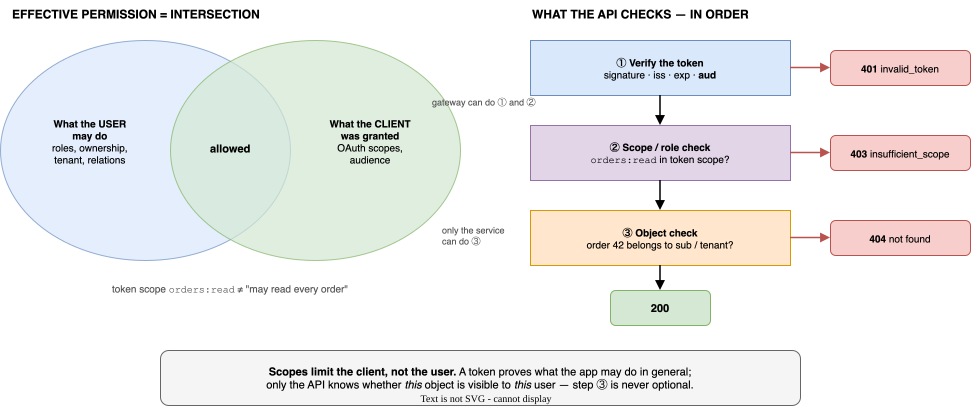

# Scopes & Claims

## What it is

Tokens issued by an authorization server can carry **authorization data**
alongside identity:

| Mechanism | What it expresses | Standard |
| --- | --- | --- |
| **OAuth scope** | What the *client application* has been allowed to do on the user's behalf | [RFC 6749 §3.3](https://www.rfc-editor.org/rfc/rfc6749#section-3.3) |
| **Audience (`aud`)** | Which API the token is valid for | [RFC 7519 §4.1.3](https://www.rfc-editor.org/rfc/rfc7519#section-4.1.3), [RFC 8707](https://www.rfc-editor.org/rfc/rfc8707) |
| **Role / group claims** | What the *user* is entitled to | [RFC 9068 §2.2.3](https://www.rfc-editor.org/rfc/rfc9068#section-2.2.3) (`roles`, `groups`, `entitlements`) |
| **`authorization_details`** | Fine-grained, structured permissions (amount, account, location) | [RFC 9396](https://www.rfc-editor.org/rfc/rfc9396) — Rich Authorization Requests |

!!! quote "Scopes limit the client, not the user"
    A scope says "this app may read your calendar." It does **not** say
    "this user may read every calendar." The effective permission is the
    **intersection** of what the user is allowed to do and what the client
    was granted.

## How it works

{ loading=lazy }

*Editable source: `docs/diagrams/scope-vs-object.drawio`*

The client requests `scope=orders:read` with `resource=https://api.example.com`,
the user consents, and the authorization server issues an access token
carrying `aud`, `scope`, `sub`, and `tenant`. The API then runs the three
checks above on every request.

Step 3 is not optional. A token with `orders:read` proves the client may
read orders *in general*; only the API knows whether *this* order is
visible to *this* user.

## Designing scopes

- **Resource + action**: `orders:read`, `orders:write`, `invoices:approve`.
  Predictable and greppable.
- **Coarse, stable, few.** Scopes are shown on consent screens and baked
  into clients. Dozens of scopes are fine; thousands mean you are using
  scopes for something they're not designed for.
- **Never encode object IDs in scopes** (`orders:42:read`). Use RAR
  `authorization_details` or a server-side check instead.
- **Separate read from write** and keep destructive/admin actions in their
  own scopes so they can be withheld.
- **Bind tokens to an audience.** One token per API, not one token for
  everything. A token for `reporting-api` must be rejected by `payments-api`.

## What belongs in a token — and what doesn't

| Put in the token | Look up server-side |
| --- | --- |
| `sub`, `tenant`/`org_id`, `aud`, `scope` | Ownership of specific objects |
| Stable, coarse roles (`admin`, `member`) | Volatile permissions that must revoke instantly |
| `acr`/`amr` (how the user authenticated) | Large permission sets (token bloat, header size limits) |
| `auth_time` (for step-up decisions) | Anything sensitive — JWT payloads are readable by anyone holding the token |

!!! warning "Claims are a snapshot"
    A JWT is a frozen copy of the user's permissions at issue time. If an
    admin is demoted, their existing token still says `admin` until it
    expires. Keep access-token TTLs short (≤15 minutes) and re-check
    high-risk actions against live data.

## Reference implementation

=== "Python (FastAPI + PyJWT)"

    ```python
    import jwt
    from fastapi import Depends, FastAPI, HTTPException, Security
    from fastapi.security import HTTPBearer

    app = FastAPI()
    bearer = HTTPBearer()
    jwks = jwt.PyJWKClient("https://auth.example.com/.well-known/jwks.json")

    def claims(creds=Security(bearer)) -> dict:
        try:
            key = jwks.get_signing_key_from_jwt(creds.credentials).key
            return jwt.decode(creds.credentials, key, algorithms=["RS256"],
                              audience="https://api.example.com",
                              issuer="https://auth.example.com")
        except jwt.PyJWTError:
            raise HTTPException(401, "Invalid token")

    def require_scope(scope: str):
        def checker(c: dict = Depends(claims)) -> dict:
            if scope not in c.get("scope", "").split():
                raise HTTPException(403, "insufficient_scope")
            return c
        return checker

    @app.get("/orders/{order_id}")
    def get_order(order_id: int, c: dict = Depends(require_scope("orders:read"))):
        order = orders.find(order_id, tenant_id=c["tenant"])   # object check
        if order is None or order.owner_id != c["sub"]:
            raise HTTPException(404)
        return order
    ```

=== "Java (Spring Security resource server)"

    ```java
    @Configuration
    @EnableMethodSecurity
    public class SecurityConfig {
        @Bean
        SecurityFilterChain api(HttpSecurity http) throws Exception {
            return http
                .authorizeHttpRequests(a -> a
                    .requestMatchers(HttpMethod.GET, "/orders/**")
                        .hasAuthority("SCOPE_orders:read")
                    .requestMatchers(HttpMethod.POST, "/orders/**")
                        .hasAuthority("SCOPE_orders:write")
                    .anyRequest().denyAll())                  // deny by default
                .oauth2ResourceServer(o -> o.jwt(Customizer.withDefaults()))
                .build();
        }
    }
    // application.yml:
    //   spring.security.oauth2.resourceserver.jwt.issuer-uri: https://auth.example.com
    //   spring.security.oauth2.resourceserver.jwt.audiences: https://api.example.com
    ```

=== "Error response"

    ```http
    HTTP/1.1 403 Forbidden
    WWW-Authenticate: Bearer error="insufficient_scope",
                      scope="orders:read"
    ```

    [RFC 6750 §3.1](https://www.rfc-editor.org/rfc/rfc6750#section-3.1)
    defines `insufficient_scope` for exactly this case.

## Token exchange for downstream calls

When API A calls API B on behalf of a user, don't forward the user's token
as-is — it was issued for A's audience and may carry more scope than B
needs. Use [RFC 8693 Token Exchange](https://www.rfc-editor.org/rfc/rfc8693)
to obtain a new token scoped down to B, with an `act` claim recording that
A is acting for the user.

## Common mistakes & mitigations

| Mistake | Detail | Mitigation |
| --- | --- | --- |
| Scope treated as full authorization | `orders:read` lets any user read every order | Always follow the scope check with an object check |
| No audience check | A token for one API is replayed against another | Validate `aud` on every API; issue per-API tokens |
| Trusting unverified claims | Reading roles from a decoded-but-unverified JWT | Verify signature, `iss`, `exp`, `aud` before reading any claim |
| Using the ID token for API access | ID tokens are for the client, not resource servers | APIs accept access tokens only |
| Token bloat | Hundreds of groups in a JWT exceed header limits | Keep tokens coarse; resolve fine-grained permissions server-side |
| Forwarding user tokens downstream | Over-scoped tokens reach services that don't need them | Token exchange (RFC 8693) with narrower scope and audience |

## When to use / avoid

!!! success "Use scopes and claims for"
    - Limiting what third-party and first-party *clients* may do
    - Coarse, slowly-changing entitlements (tenant, plan, admin flag)
    - Fast, stateless function-level checks at the gateway or service edge

!!! failure "Don't use them for"
    - Object-level permissions ("may read order 42")
    - Permissions that must be revoked immediately
    - Sensitive data — anyone with the token can decode the payload

## Checklist

- [x] Every API validates `aud` and rejects tokens issued for other APIs
- [x] Scope check on every endpoint, deny by default for unmapped routes
- [x] Scope check is always followed by an object-level check
- [x] Access-token TTL ≤15 minutes; volatile permissions looked up live
- [x] Downstream calls use token exchange, not token forwarding
- [x] `403 insufficient_scope` returned when scope is missing
