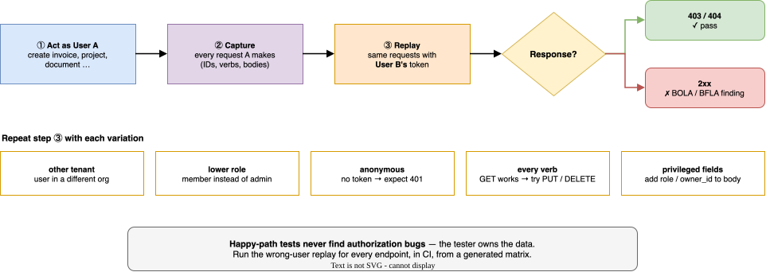

# Testing & Pitfalls

## What it is

Authorization bugs rarely show up in functional tests — the happy path
works, because the tester is using their own data. You have to test the
**unhappy paths deliberately**: the wrong user, the wrong tenant, the wrong
role, the wrong verb.

## How it works

### The authorization test matrix

For every endpoint, enumerate actors × actions × objects and assert the
expected outcome:

| Actor | `GET /invoices/{own}` | `GET /invoices/{other user}` | `GET /invoices/{other tenant}` | `DELETE /invoices/{own}` |
| --- | :-: | :-: | :-: | :-: |
| Anonymous | 401 | 401 | 401 | 401 |
| Member | 200 | 404 | 404 | 403 |
| Tenant admin | 200 | 200 | 404 | 204 |
| Token missing `invoices:read` | 403 | 403 | 403 | 403 |

The matrix *is* the specification. Generate tests from it so a new endpoint
can't ship without rows.

### The two-user test

The single most effective BOLA test: create resources as **User A**, then
replay every request with **User B's** token. Anything other than
403/404 is a finding.

{ loading=lazy }

*Editable source: `docs/diagrams/two-user-test.drawio`*

## Reference implementation

=== "Python (pytest + httpx)"

    ```python
    import pytest

    CASES = [
        # (actor,          method,   path_template,           expected)
        ("anonymous",     "GET",    "/invoices/{alice_inv}",  401),
        ("alice",         "GET",    "/invoices/{alice_inv}",  200),
        ("bob",           "GET",    "/invoices/{alice_inv}",  404),  # BOLA
        ("mallory_other", "GET",    "/invoices/{alice_inv}",  404),  # cross-tenant
        ("alice",         "DELETE", "/invoices/{alice_inv}",  403),  # BFLA
        ("acme_admin",    "DELETE", "/invoices/{alice_inv}",  204),
    ]

    @pytest.mark.parametrize("actor,method,path,expected", CASES)
    def test_invoice_authorization(client, tokens, fixtures, actor, method, path, expected):
        headers = {} if actor == "anonymous" else {"Authorization": f"Bearer {tokens[actor]}"}
        r = client.request(method, path.format(**fixtures), headers=headers)
        assert r.status_code == expected
    ```

=== "Java (JUnit 5 + MockMvc)"

    ```java
    @SpringBootTest
    @AutoConfigureMockMvc
    class InvoiceAuthorizationTest {

        @Autowired MockMvc mvc;

        static Stream<Arguments> cases() {
            return Stream.of(
                Arguments.of("bob",   "SCOPE_invoices:read", HttpStatus.NOT_FOUND),  // BOLA
                Arguments.of("alice", "SCOPE_invoices:read", HttpStatus.OK),
                Arguments.of("alice", "SCOPE_profile",       HttpStatus.FORBIDDEN)); // scope
        }

        @ParameterizedTest
        @MethodSource("cases")
        void getInvoice(String sub, String authority, HttpStatus expected) throws Exception {
            mvc.perform(get("/invoices/{id}", ALICE_INVOICE_ID)
                    .with(jwt().jwt(j -> j.subject(sub))
                               .authorities(new SimpleGrantedAuthority(authority))))
               .andExpect(status().is(expected.value()));
        }
    }
    ```

=== "Policy unit test (OPA)"

    ```rego
    package httpapi.authz_test

    import data.httpapi.authz

    test_owner_can_read if {
        authz.allow with input as {"action": "read",
            "subject": {"id": "alice"}, "resource": {"owner": "alice"}}
    }

    test_other_user_cannot_read if {
        not authz.allow with input as {"action": "read",
            "subject": {"id": "bob"}, "resource": {"owner": "alice"}}
    }
    ```

## Testing techniques

- **Route inventory diff.** Compare the router's registered routes (or the
  OpenAPI spec) against routes that declare an authorization rule. Fail CI
  on any route without one.
- **Verb tampering.** For every `GET` that works, try `PUT`, `PATCH`,
  `DELETE`, and `HEAD` with the same token.
- **Parameter pollution.** Send the ID in path *and* body (`/users/1` with
  `{"id": 2}`), duplicate query parameters, and alternate encodings.
- **Property fuzzing.** Add privileged fields (`role`, `is_admin`,
  `tenant_id`, `owner_id`) to every write payload and assert they're
  ignored or rejected.
- **Response diffing.** Compare responses across roles to catch fields that
  leak to lower-privileged callers.
- **DAST and proxies.** Tools like Burp Suite's Autorize extension or
  OWASP ZAP replay a high-privilege session's traffic with a low-privilege
  token — on systems you are authorized to test.

## Common pitfalls

| Pitfall | Why it fails | Fix |
| --- | --- | --- |
| Client-side authorization | Hidden buttons and routes don't stop direct API calls | Every check enforced server-side |
| Fail-open defaults | Exceptions or unknown roles fall through to "allow" | Explicit deny-by-default; test the unknown-role case |
| Trusting client identity | `user_id`, `tenant_id`, or `role` read from the request | Identity and tenant come only from the verified credential |
| Check-then-act races (TOCTOU) | Permission checked, then object changes owner before the write | Check and write in one transaction / conditional update |
| Inconsistent checks across channels | REST checks ownership; GraphQL, gRPC, websocket, or export doesn't | Shared authorization layer used by every entry point |
| Stale permissions | Removed users keep access via long-lived tokens or caches | Short TTLs, cache invalidation on permission change |
| Error messages leak existence | 403 for "exists but not yours", 404 for "doesn't exist" | Return 404 for both when existence is sensitive |
| Only testing as admin | Developers test with full permissions, so nothing ever fails | Default test fixtures use the least-privileged role |

## Checklist

- [x] An authorization matrix exists for every resource and is turned into tests
- [x] Two-user (BOLA) and cross-tenant tests run in CI
- [x] CI fails on any route without an authorization rule
- [x] Write endpoints are fuzzed with privileged properties
- [x] Policies have unit tests covering both allow and deny
- [x] Periodic manual or DAST testing with low-privilege tokens
