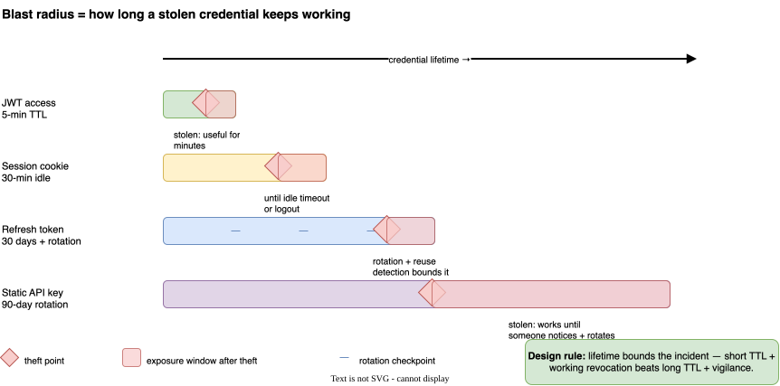
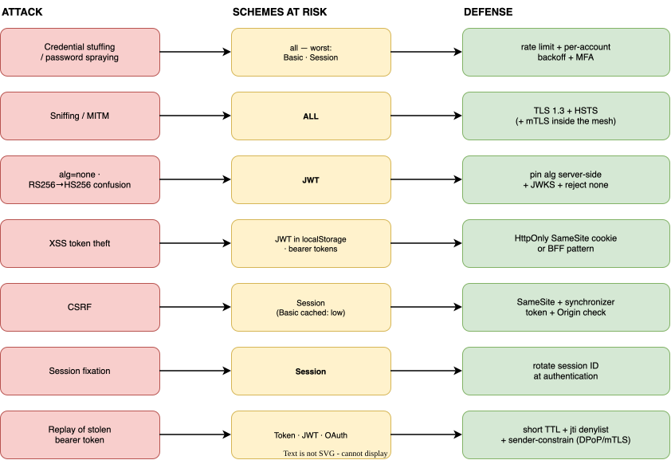
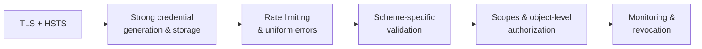

# Security Best Practices

Cross-cutting controls that apply to **every** authentication scheme in
this guide. Scheme-specific checklists live on each scheme's page.

## Transport security

- [x] **TLS on every endpoint.** No exceptions for "internal" traffic —
      use mTLS or a service mesh if you want defense in depth.
- [x] **Reject or redirect port 80** — never serve auth over plaintext.
- [x] **Enable HSTS** (`Strict-Transport-Security: max-age=31536000;
      includeSubDomains`) so browsers never retry HTTP.
- [x] **Modern TLS only** — TLS 1.2+; disable 1.0/1.1 and weak ciphers.

## Credential & token hygiene

{ loading=lazy }

*Editable source: `docs/diagrams/credential-lifetime.drawio`*

- [x] **CSPRNG for anything security-relevant** — `secrets` (Py),
      `SecureRandom` (Java), `crypto` (Node). ≥128 bits.
- [x] **Hash credentials at rest** — passwords: bcrypt/argon2;
      API keys/refresh tokens: SHA-256 (they're already high-entropy).
- [x] **Short lifetimes** — access tokens ≤15 min, sessions ≤30 min idle,
      API keys with explicit expiry dates.
- [x] **Rotate on a schedule** and provide a revocation path that works —
      test it, don't just document it.
- [x] **Never in source control.** Secrets in env vars, mounted files, or
      a secrets manager (Vault, Secrets Manager, KMS). Scan repos with
      `gitleaks`/`trufflehog` in CI.

## Never log secrets

The most common real-world leak isn't cryptographic — it's observability
pipelines:

- [x] Scrub `Authorization`, `Cookie`, `X-API-Key` headers from access logs.
- [x] Exclude token fields from APM/distributed tracing attributes.
- [x] Ensure error-reporting tools (Sentry etc.) strip auth headers.
- [x] Never put credentials in URLs — they land in logs *everywhere*.

## Rate limiting & brute-force defense

- [x] Rate-limit **authentication attempts** per IP *and* per account.
- [x] Exponential backoff or temporary lockout after repeated failures.
- [x] Uniform failure responses — "invalid credentials," never "user not
      found" vs. "wrong password" (stops user enumeration).
- [x] Constant-time comparisons for credentials/tokens.
- [x] CAPTCHA or proof-of-work on public login endpoints under attack.

## Authentication ≠ authorization

Every scheme in this guide proves *who* the caller is. Separately enforce:

- [x] **Scope/role checks on every endpoint** — a valid token for
      `read:photos` must not pass `POST /admin`.
- [x] **Object-level authorization** — "user is authenticated" doesn't
      mean "user may read *this* record" (IDOR/BOLA — OWASP API #1).
- [x] **Least privilege** — issue the narrowest scopes the client needs.

## Monitoring & incident response

- [x] Alert on auth anomalies: failure spikes, impossible-travel logins,
      token reuse after rotation, new-device access.
- [x] Log auth *events* (who/when/what result) — never the credentials.
- [x] Have a "break glass" path: global token invalidation
      (`min_iat` bump, signing-key rotation, session-store flush).
- [x] Practice the revocation drill before you need it.

## Scheme-attack quick map

| Attack | Basic | API Key | JWT | OAuth | Session |
| --- | :-: | :-: | :-: | :-: | :-: |
| Sniffing without TLS | ●●● | ●●● | ●●● | ●●● | ●●● |
| Brute force | ●●● | ●● | ●● (weak secrets) | ●● | ●●● |
| XSS theft | ●● | ●● | ●●● | ●● | ● (HttpOnly) |
| CSRF | ● | – | – | – | ●●● |
| Replay after theft | ●●● | ●●● | ●●● (until exp) | ●● | ●●● |
| Misconfiguration | ● | ● | ●●● | ●●● | ●● |
| Poor revocation | ●●● | ● | ●●● | ● | – |

● = exposure level (more dots, more risk) · – = not applicable

{ loading=lazy }

*Editable source: `docs/diagrams/attack-defense-map.drawio`*

## Defense-in-depth layering

No single layer is sufficient — a perfectly signed JWT on plaintext HTTP is
still a breach. Stack them.
