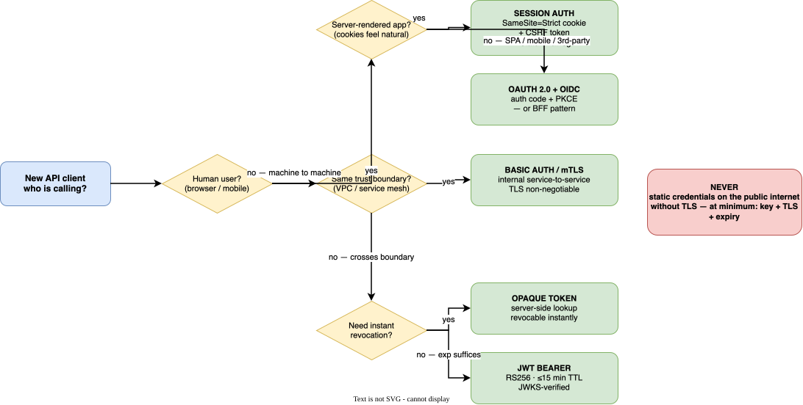

# Comparison & Selection Guide

## Feature matrix

| | Basic Auth | API Key | Bearer Token | JWT | OAuth 2.0 | Session |
| --- | --- | --- | --- | --- | --- | --- |
| **Credential on wire** | Password (B64) | Opaque key | Opaque token | Signed token | Access token | Session ID |
| **Server lookup required** | Yes (verify password) | Yes | Yes | No | Depends (JWT: no) | Yes |
| **Stateless** | Yes | Yes | Yes | Yes | Access token: often | No |
| **Built-in expiry** | No | Optional | Optional | Yes (`exp`) | Yes | Yes (TTL) |
| **Revocation** | Change password | Delete key | Delete token | Wait for `exp` / blacklist | Revoke / `exp` | Instant |
| **Scopes/permissions** | No | Usually | Usually | Claims | Yes (`scope`) | Server-side |
| **CSRF risk** | Low¹ | None | None | None | None | **High — needs defense** |
| **XSS theft risk** | Medium | Medium | Medium | High (if in JS storage) | Medium | Low (`HttpOnly`) |
| **Mobile-friendly** | Poor | OK | OK | Good | Good | Poor |
| **Spec/standard** | RFC 7617 | De facto | RFC 6750 | RFC 7519 | RFC 6749 + BCP | Framework |
| **Complexity** | Minimal | Low | Low | Medium | High | Low |

¹ Browsers that cache Basic credentials *can* replay them cross-site in
some configurations, but it's far less prevalent than cookie CSRF.

## Decision tree

{ loading=lazy }

*Editable source: `docs/diagrams/decision-tree.drawio`*

## Quick recommendations by scenario

| Scenario | Recommended |
| --- | --- |
| Public REST API for developers | API keys for simple use; OAuth if users' data is accessed |
| Mobile app + your own backend | OAuth/OIDC issuing short-lived JWTs + refresh tokens |
| SPA + your own backend | Auth Code + PKCE via IdP, or BFF pattern with cookies |
| Microservice → microservice | JWT (RS256, from your IdP) or mTLS |
| Server-rendered monolith | Session auth + CSRF tokens |
| Cron/CI calling internal endpoint | API key or Basic over mTLS/private network |
| Webhook receiver verifying sender | HMAC signature (out of scope here) or Basic + IP allowlist |
| Smart TV / CLI tool | OAuth Device Authorization grant |

## Common real-world combinations

Schemes compose — production systems rarely pick exactly one:

- **OAuth 2.0 issuing JWTs** — the dominant pattern: OAuth for the
  *issuance* ceremony, JWTs as the *access token format*.
- **Session + CSRF token** — sessions always pair with a CSRF defense.
- **API key + HMAC signature** — high-security APIs (payment providers)
  often layer request signing on top of the key.
- **Basic auth → token exchange** — Basic credentials presented *once* to
  mint a bearer token, then discarded.

## The honest trade-off

> **Statelessness buys scale and costs revocability.**
>
> JWTs verify locally → horizontal scaling is free, but a stolen token
> works until `exp`. Sessions/API keys need a lookup per request → one
> more dependency, but revocation is instant. Choose your poison
> consciously; short `exp` + refresh tokens is the standard compromise.
