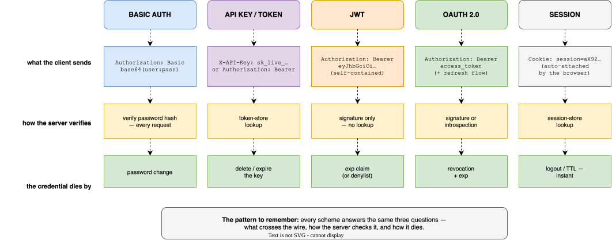

# API Security: Authentication & Authorization

A language-agnostic field guide to the dominant API authentication schemes,
the mechanisms that surround them (MFA, SSO, passkeys, mTLS, request
signing), and the authorization patterns that sit on top of them all. Every topic is explained
systematically — how it works on the wire, reference implementations
(Python / Java), known weaknesses, common attacks, and when to use or avoid it.

!!! info "Authentication vs. Authorization"
    **Authentication** answers *"who are you?"* — covered in
    [Authentication Schemes](authentication/index.md).
    **Authorization** answers *"what are you allowed to do?"* — roles,
    scopes, object ownership, and policy, covered in
    [Authorization](authorization/index.md). A correctly implemented
    authentication scheme is a prerequisite for authorization, not a
    substitute for it.

## The five schemes at a glance

| Scheme | Credential sent | Stateful? | Revocation | Typical use case |
| --- | --- | --- | --- | --- |
| [Basic Auth](authentication/basic-auth.md) | `Base64(username:password)` every request | No | Change the password | Internal tools, webhooks, dev/test |
| [Token Auth](authentication/token-auth.md) | API key / bearer token | Usually (lookup per request) | Delete/rotate token | Server-to-server, partner APIs |
| [JWT](authentication/jwt.md) | Signed self-contained token | No | TTL expiry or blacklist | Microservices, SPAs, mobile |
| [OAuth 2.0](authentication/oauth.md) | Access token issued via grant flows | Depends on token type | Revocation endpoint / TTL | Delegated access, 3rd-party integration |
| [Session Auth](authentication/session-auth.md) | Session ID cookie | Yes (server store) | Destroy session | Server-rendered web apps |

{ loading=lazy }

*Editable source: `docs/diagrams/schemes-overview.drawio`*

## Adjacent mechanisms

| Mechanism | Where it fits | Read it for |
| --- | --- | --- |
| [MFA](authentication/mfa.md) | Strengthens user login; claims carry the result | Factor categories, step-up auth, `acr`/`amr` |
| [Enterprise SSO](authentication/enterprise-sso.md) | Delegates login to a corporate IdP | SAML vs OIDC, LDAP/AD, federation pitfalls |
| [Passkeys](authentication/passkeys.md) | Replaces the password factor | WebAuthn ceremonies, phishing resistance |
| [Mutual TLS](authentication/mtls.md) | Authenticates the *connection* for machine callers | Workload identity, SPIFFE/SPIRE, service mesh |
| [Request Signing](authentication/request-signing.md) | Proves integrity of each request | HMAC canonicalization, webhooks, replay defense |

## Authorization at a glance

| Topic | Question it answers | Typical failure |
| --- | --- | --- |
| [Access-Control Models](authorization/models.md) | How are permissions expressed — ACL, RBAC, ABAC, ReBAC? | Role explosion, role checks hard-coded everywhere |
| [Scopes & Claims](authorization/scopes-claims.md) | What may this *client* do, and for which API? | Scope treated as full authorization; no `aud` check |
| [Object & Function Level](authorization/object-level.md) | May this caller touch *this* record, field, or operation? | BOLA / IDOR, mass assignment, hidden admin endpoints |
| [Policy Engines & Enforcement](authorization/policy-engines.md) | Where is the decision made, and where is it enforced? | Gateway-only checks, fail-open on PDP errors |
| [Multi-Tenancy & Delegation](authorization/multi-tenancy.md) | How is tenant data isolated; who acts for whom? | Tenant ID trusted from a header, unaudited impersonation |
| [Testing & Pitfalls](authorization/testing.md) | How do you prove authorization works? | Only testing as the resource owner or as admin |
| [Worked Example: RBAC API](authorization/rbac-design.md) | How do admin, manager, and user share one API safely? | Role checked but data scope and fields aren't |

## How the guide is organized

-   :material-lock: **Basic Auth**

    ---

    The simplest scheme — credentials on every request. Learn why it's fine
    for a cron job and dangerous for the public internet.

    [:octicons-arrow-right-24: Read](authentication/basic-auth.md)

-   :material-key: **Token Auth**

    ---

    API keys and bearer tokens — opaque strings checked against a store.
    The workhorse of server-to-server authentication.

    [:octicons-arrow-right-24: Read](authentication/token-auth.md)

-   :material-certificate: **JWT**

    ---

    Cryptographically signed, self-contained tokens. Powerful — and the
    most commonly misconfigured scheme in this guide.

    [:octicons-arrow-right-24: Read](authentication/jwt.md)

-   :material-account-key: **OAuth 2.0**

    ---

    A delegation framework, not a single mechanism. Grant types, PKCE,
    access vs. refresh vs. ID tokens.

    [:octicons-arrow-right-24: Read](authentication/oauth.md)

-   :material-cookie: **Session Auth**

    ---

    The original web scheme: stateful sessions behind a cookie. Still the
    right answer for server-rendered applications.

    [:octicons-arrow-right-24: Read](authentication/session-auth.md)

-   :material-account-lock: **Authorization**

    ---

    Access-control models, scopes and claims, BOLA/BFLA, policy engines,
    multi-tenancy, and how to test it all.

    [:octicons-arrow-right-24: Read](authorization/index.md)

-   :material-scale-balance: **Comparison**

    ---

    Side-by-side decision matrix and a selection flowchart for picking the
    right scheme for your API.

    [:octicons-arrow-right-24: Read](comparison.md)

## The golden rules

Regardless of which scheme you choose, these are non-negotiable:

1. **TLS everywhere.** Every scheme in this guide is trivially broken on
   plaintext HTTP. Terminate TLS correctly and enable HSTS.
2. **Never log credentials or tokens.** Scrub `Authorization` headers and
   cookies from access logs, error reports, and APM traces.
3. **Authenticate, then authorize.** Verifying identity says nothing about
   permissions — enforce scope/role checks on every endpoint and
   ownership checks on every object (see [Authorization](authorization/index.md)).
4. **Rate-limit authentication endpoints.** Brute force and credential
   stuffing are the most common attacks against every scheme here.
5. **Prefer short-lived credentials.** The longer a stolen credential
   works, the worse the incident.

See [Security Best Practices](best-practices.md) for the full checklist.
